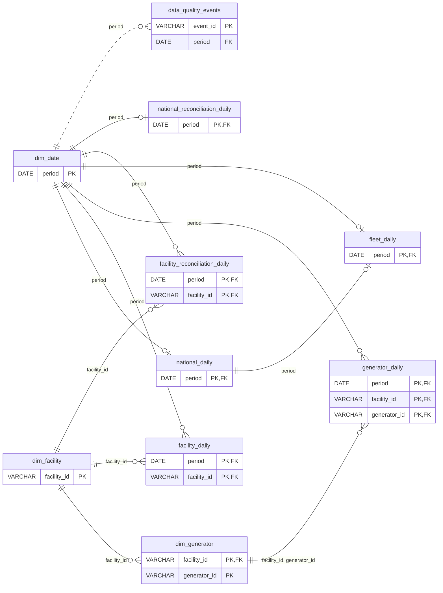

# Analytical data model, version 2

This model gives each published grain its own daily fact table, then adds explicit reconciliation and quality datasets. It preserves source observations while making their relationships, units and limitations inspectable. The national source remains the numerator and denominator for the US-08 fleet metric; child sums are independent checks rather than replacements for published national values.

The executable contract is [model_contracts.py](../src/outage_explorer/model_contracts.py). The transformation is [modeling.py](../src/outage_explorer/modeling.py). A published model's `manifest.json` captures the exact contract, source bindings, checksums and metric version used for that bundle.

## Grain, identity and relationships

| Dataset | One row represents | Primary key |
| --- | --- | --- |
| `dim_date` | A date observed in at least one source grain | `period` |
| `dim_facility` | A facility identity observed in either detail route | `facility_id` |
| `dim_generator` | A generator identity within its facility | `facility_id, generator_id` |
| `national_daily` | A published national observation for a date | `period` |
| `facility_daily` | A published facility observation for a date | `period, facility_id` |
| `generator_daily` | A published generator observation for a date | `period, facility_id, generator_id` |
| `fleet_daily` | The versioned national offline-capacity metric for a date | `period` |
| `facility_reconciliation_daily` | A facility/date observed in the facility route or its generator aggregate | `period, facility_id` |
| `national_reconciliation_daily` | A date observed in any source grain | `period` |
| `data_quality_events` | A deterministic review event for an observed date/entity/rule | `event_id` |

Identifiers are `VARCHAR`. A generator named `1` at one facility differs from generator `1` at another. Names are descriptions, never join keys. Facts retain observation-time facility names. `dim_facility.facility_name` is the latest non-null observed name; same-date ties prefer the facility route, then deterministic name ordering. This is a current descriptive dimension, not a slowly changing history. Future ownership/name history should use an explicit temporal dimension rather than overwrite historical facts.

Facility identities are the union of both detail routes. This preserves a generator whose facility-day parent is absent. `generator_daily` references `dim_generator`, **not** `facility_daily`: an FK to the latter would reject the coverage anomalies reconciliation must expose. National reconciliation references the date dimension and can exist without a national source row. Observed first/last dates do not assert commissioning or retirement dates.

The diagram shows every declared PK/FK and omits non-key attributes for readability. The complete column reference follows below. The diagram source is [ER.mmd](ER.mmd).



Before publication, primary keys are checked for uniqueness and non-null values, and each declared FK is checked with an anti-join. These are executable model constraints; standalone Parquet files do not enforce relational constraints. Catalog metadata exposes the same keys to consumers.

`dim_date` is the union of observed source dates, not proof that every calendar date or entity is present. Complete-calendar queries must explicitly generate/join that calendar and preserve missing observations. Interior-gap events detect missing dates between observations without manufacturing facts or asserting membership before an entity's first or after its last observation.

## US-08 metric contract

`fleet_daily.offline_share` is the fraction of published national capacity reported offline on a date:

```text
ratio = national_daily.outage_mw / national_daily.capacity_mw
offline_share = quantize(ratio, 12 decimal places)
offline_pct = quantize(100 * ratio, 9 decimal places)
reported_vs_calculated_pct_gap = reported_outage_pct - offline_pct
```

The metric definition remains version **1**. Both outputs use the unrounded ratio and Python `Decimal`, precision **28**, **`ROUND_HALF_UP`**. `offline_pct` is not calculated from the already quantized share. Storage types are `DECIMAL(24,12)` for the share and `DECIMAL(24,9)` for the percentage. On September 3, 2026, 1,507.338 MW / 97,620.5 MW yields share `0.015440793686`, calculated percent `1.544079369`, and separately preserved reported percent `1.540000000`.

Null/non-positive capacity or null outage makes both derived outputs null and adds `metric_undefined`. Source flags remain visible. Finite out-of-range values are preserved with flags rather than clipped into 0–100%. The 91 Indian Point zero-capacity observations remain in the base facts despite not supporting a valid ratio.

The metric describes **EIA/NRC-reported offline capacity**, not energy generated, daily MWh loss or capacity factor. Daily reported capacity/status is not an integral of electricity output. Show the numerator, denominator and observation date. [EIA capacity and generation definitions](https://www.eia.gov/tools/faqs/faq.php?id=101&t=3).

```sql
SELECT period, capacity_mw, outage_mw, offline_share, offline_pct,
       reported_outage_pct, reported_vs_calculated_pct_gap, quality_flags
FROM fleet_daily
WHERE period BETWEEN DATE '2026-09-01' AND DATE '2026-09-30'
ORDER BY period;
```

A combined-period summary uses `SUM(outage_mw) / SUM(capacity_mw)` over the intended observed daily population, not summed percentages or an unweighted average of generator percentages. This is a capacity-day weighted share, not MWh loss; missing dates require an explicit coverage assessment.

## Reconciliation and quality policy

Observed generator sums are compared to published facilities; facility and generator sums are separately compared to published national values. Full outer joins preserve missing parents and children. Counts and null counts accompany aggregates. If any contributing measure is null, that measure's aggregate is null; `SUM` cannot hide it. An absent aggregate has count zero and null measures rather than zero MW.

All model MW gaps are **child aggregate minus published parent**. Absolute-gap columns retain magnitude alongside direction. A facility reported-percentage gap is its capacity-weighted generator reported percentage minus its own reported percentage. National percentage gaps compare each child grain's capacity-weighted published percentages to the national reported percentage. These preserve rounding effects while the fleet metric independently uses MW measures.

| Diagnostic | Values and policy |
| --- | --- |
| `coverage_status` | `both_observed`, `missing_parent`, `missing_children`, `null_measure` |
| `mw_comparison_status` | `exact` at zero; `within_tolerance` when every absolute gap is ≤0.01 MW; otherwise `mismatch`; `undefined` when a required gap is null |
| `pct_comparison_status` | `exact`; `within_rounding_tolerance` at ≤0.005 percentage points; `mismatch`; `undefined` |
| Weighted reported percentage | `SUM(child_capacity_mw * child_reported_pct) / SUM(child_capacity_mw)`; requires every capacity/percentage and a positive denominator; quantized to 9 places with `Decimal`, precision 28, `ROUND_HALF_UP` |

Tolerances are review policies, not permission to alter source values; exact nonzero gaps remain available. The independent [reconciliation SQL](../src/outage_explorer/sql/reconciliation.sql) tests rounding with scaled integers before division. A rounding-compatible percentage difference need not imply an MW mismatch. Decimal facts and totals avoid binary floating-point classification errors.

Quality events are review warnings and never establish a physical cause:

| Rule | Trigger |
| --- | --- |
| `zero_capacity` | Capacity equals zero |
| `zero_capacity_positive_reported_pct` | Capacity equals zero and reported percentage is positive |
| `source_<flag>` | A preserved source flag, including `source_capacity_non_positive` |
| `entity_coverage_gap` | Same-identity observations are more than one calendar day apart; `gap_days` counts intervening missing days |
| `capacity_change` | Consecutive calendar-day observations, positive previous capacity, absolute change ≥100 MW **and** relative change ≥10% |
| `missing_parent` / `missing_children` | Facility reconciliation lacks the corresponding source parent or child aggregate |

IDs hash the rule, date, grain, facility, generator and previous date, keeping equivalent events stable across rebuilds. Smaller capacity changes remain queryable in facts: Grand Gulf's 273 MW step meets the rule, while Peach Bottom's 82 MW example is below it. Source coverage may be incomplete when every grain sum agrees, as [FINDINGS.md](../FINDINGS.md) demonstrates with River Bend.

## Physical storage and publication

```text
data/
  snapshots/<source_id>/
    national.parquet, facility.parquet, generator.parquet, manifest.json
  models/<model_id>/
    <dataset_id>.parquet  # one file per registered dataset
    manifest.json
  catalog.sqlite3
```

Each immutable bundle writes one file per dataset, sorted by its PK, with **ZSTD** compression and target row groups of **122,880 rows**. Daily facts sort by date first, enabling date-filter pruning through row-group statistics; dimensions sort by identity. DuckDB can project needed columns without loading entire files into application memory.

Version 2 deliberately avoids year/entity directory partitions. The actual raw snapshot is approximately **46.388 MB** in total: national 0.447 MB, facility 17.745 MB, generator 28.196 MB. Annual or facility partitions would create many small files and metadata/open overhead. A guideline such as 100 MB per partition is a sizing heuristic, not a reason to split this small dataset. Revisit annual partitions after measured growth and representative date-filter benchmarks demonstrate a benefit. Retain date/key sorting and avoid a collection of roughly 1 MB files; row groups already provide a pruning unit at this scale.

Manifests record byte-level SHA-256 checksums. Model datasets also have a logical SHA-256 over canonically encoded typed rows in PK order, supporting rebuild comparison when a writer version changes physical Parquet bytes. Decimals use fixed-point encoding for the fingerprint. The model manifest records schemas, keys, units, classifications, date bounds, counts, source file bindings, metric definitions, rule counts and storage policy.

Ingest builds and verifies a model for its candidate source before publication. SQLite publishes source and model pointers in **one transaction**. Failure leaves the previous pair available. A standalone build pins the current source and can publish only if it is still current at commit; otherwise it fails as stale. Readers resolve coupled pointers together and reject mismatches. Historical immutable bundles and build history remain available.

Column types, identity, metric semantics and source-unit changes require an explicit model-version decision. Unexpected source schema or unit drift fails validation instead of being silently coerced.

Model version **2** corrects catalog unit labels: absolute percentage values use `percent`, while differences use `percentage points`. The numeric observations, schemas and fleet metric formula are unchanged. The development version 1 contract is frozen in [model-v1.json](../src/outage_explorer/contracts/model-v1.json); its immutable artifacts remain readable with an explicit warning about the old metadata labels. Historical metadata is preserved under its original contract rather than rewritten as the current contract. The fleet metric definition stays at version **1** because its numerical meaning has not changed.

## Catalog access metadata and operating commands

`national_daily` and `fleet_daily` have the `national` classification, allowing Viewer, Analyst and Admin. All other datasets have `detail`, listing Analyst and Admin. `model catalog --persona viewer|analyst|admin` selects corresponding metadata. This is a backend catalog policy contract, **not** HTTP authentication/authorization. A future API must obtain the persona from trusted identity and enforce policy before query execution; caller-selected personas or client SQL are not authorization.

These commands use local snapshots and need no EIA API key:

```powershell
.\.venv\Scripts\python.exe -m outage_explorer model build
.\.venv\Scripts\python.exe -m outage_explorer model verify
.\.venv\Scripts\python.exe -m outage_explorer model catalog --persona analyst
.\.venv\Scripts\python.exe -m outage_explorer model report --start 2026-09-01 --end 2026-09-30 --output work/part2-report.json
.\.venv\Scripts\python.exe -m outage_explorer model history
```

The evidence in [FINDINGS.md](../FINDINGS.md) pins model `e5721cad365d47beb0a8a322199a3138` with `model report --model-id`, so subsequent ingests do not change that analysis.

The report executes application-owned [reconciliation.sql](../src/outage_explorer/sql/reconciliation.sql) and [part2_findings.sql](../src/outage_explorer/sql/part2_findings.sql) over catalog-registered logical datasets. Date values are bound as parameters, not SQL fragments. These fixed evidence queries require neither arbitrary user SQL nor source filesystem paths.

## Complete column reference

`PK`/`FK` indicate membership in declared keys, including composite keys. Keys are non-null by validated contract; other columns may be null when an observation or comparison is unavailable. `DATE` is an observation date without an invented intraday timestamp. Base MW measures use `DECIMAL(24,9)`; aggregate MW totals/gaps use `DECIMAL(38,9)`; percentages and percentage-point gaps use `DECIMAL(24,9)`. Flags/details are canonical JSON in `VARCHAR`. `source_row_hash` links to the preserved source row. Exact FK tuples follow each dataset.

### `dim_date`

Union of observed source dates.

| Column | Type | Key | Unit |
| --- | --- | --- | --- |
| `period` | `DATE` | PK | — |
| `year` | `INTEGER` | — | — |
| `month` | `INTEGER` | — | — |
| `day` | `INTEGER` | — | — |

No foreign keys.

### `dim_facility`

Union of source identities; latest observed descriptive name.

| Column | Type | Key | Unit |
| --- | --- | --- | --- |
| `facility_id` | `VARCHAR` | PK | — |
| `facility_name` | `VARCHAR` | — | — |
| `first_observed` | `DATE` | — | — |
| `last_observed` | `DATE` | — | — |
| `seen_in_facility_route` | `BOOLEAN` | — | — |
| `seen_in_generator_route` | `BOOLEAN` | — | — |

No foreign keys.

### `dim_generator`

Generator identity is scoped to its facility.

| Column | Type | Key | Unit |
| --- | --- | --- | --- |
| `facility_id` | `VARCHAR` | PK, FK | — |
| `generator_id` | `VARCHAR` | PK | — |
| `first_observed` | `DATE` | — | — |
| `last_observed` | `DATE` | — | — |

Foreign key: `(facility_id)` → `dim_facility(facility_id)`.

### `national_daily`

Published national observations, without cross-grain substitutions.

| Column | Type | Key | Unit |
| --- | --- | --- | --- |
| `period` | `DATE` | PK, FK | — |
| `capacity_mw` | `DECIMAL(24,9)` | — | MW |
| `outage_mw` | `DECIMAL(24,9)` | — | MW |
| `reported_outage_pct` | `DECIMAL(24,9)` | — | % |
| `quality_flags` | `VARCHAR` | — | — |
| `source_row_hash` | `VARCHAR` | — | — |

Foreign key: `(period)` → `dim_date(period)`.

### `facility_daily`

Facility observations with observation-time names.

| Column | Type | Key | Unit |
| --- | --- | --- | --- |
| `period` | `DATE` | PK, FK | — |
| `facility_id` | `VARCHAR` | PK, FK | — |
| `facility_name` | `VARCHAR` | — | — |
| `capacity_mw` | `DECIMAL(24,9)` | — | MW |
| `outage_mw` | `DECIMAL(24,9)` | — | MW |
| `reported_outage_pct` | `DECIMAL(24,9)` | — | % |
| `quality_flags` | `VARCHAR` | — | — |
| `source_row_hash` | `VARCHAR` | — | — |

Foreign key: `(period)` → `dim_date(period)`.

Foreign key: `(facility_id)` → `dim_facility(facility_id)`.

### `generator_daily`

Preserved generator observations, including missing facility-day parents.

| Column | Type | Key | Unit |
| --- | --- | --- | --- |
| `period` | `DATE` | PK, FK | — |
| `facility_id` | `VARCHAR` | PK, FK | — |
| `generator_id` | `VARCHAR` | PK, FK | — |
| `facility_name` | `VARCHAR` | — | — |
| `capacity_mw` | `DECIMAL(24,9)` | — | MW |
| `outage_mw` | `DECIMAL(24,9)` | — | MW |
| `reported_outage_pct` | `DECIMAL(24,9)` | — | % |
| `quality_flags` | `VARCHAR` | — | — |
| `source_row_hash` | `VARCHAR` | — | — |

Foreign key: `(period)` → `dim_date(period)`.

Foreign key: `(facility_id, generator_id)` → `dim_generator(facility_id, generator_id)`.

### `fleet_daily`

US-08: share of published national fleet capacity offline each day.

| Column | Type | Key | Unit |
| --- | --- | --- | --- |
| `period` | `DATE` | PK, FK | — |
| `capacity_mw` | `DECIMAL(24,9)` | — | MW |
| `outage_mw` | `DECIMAL(24,9)` | — | MW |
| `reported_outage_pct` | `DECIMAL(24,9)` | — | % |
| `offline_share` | `DECIMAL(24,12)` | — | fraction |
| `offline_pct` | `DECIMAL(24,9)` | — | % |
| `reported_vs_calculated_pct_gap` | `DECIMAL(24,9)` | — | percentage points |
| `quality_flags` | `VARCHAR` | — | — |

Foreign key: `(period)` → `dim_date(period)`.

Foreign key: `(period)` → `national_daily(period)`.

### `facility_reconciliation_daily`

Observed generator sums versus published facility; absent/null is not zero.

| Column | Type | Key | Unit |
| --- | --- | --- | --- |
| `period` | `DATE` | PK, FK | — |
| `facility_id` | `VARCHAR` | PK, FK | — |
| `facility_name` | `VARCHAR` | — | — |
| `facility_present` | `BOOLEAN` | — | — |
| `generator_count` | `INTEGER` | — | — |
| `generator_null_capacity_count` | `INTEGER` | — | — |
| `generator_null_outage_count` | `INTEGER` | — | — |
| `generator_null_pct_count` | `INTEGER` | — | — |
| `facility_capacity_mw` | `DECIMAL(24,9)` | — | MW |
| `generator_capacity_mw` | `DECIMAL(38,9)` | — | MW |
| `facility_outage_mw` | `DECIMAL(24,9)` | — | MW |
| `generator_outage_mw` | `DECIMAL(38,9)` | — | MW |
| `capacity_gap_mw` | `DECIMAL(38,9)` | — | MW |
| `outage_gap_mw` | `DECIMAL(38,9)` | — | MW |
| `capacity_abs_gap_mw` | `DECIMAL(38,9)` | — | MW |
| `outage_abs_gap_mw` | `DECIMAL(38,9)` | — | MW |
| `facility_reported_pct` | `DECIMAL(24,9)` | — | % |
| `generator_weighted_reported_pct` | `DECIMAL(24,9)` | — | % |
| `reported_pct_gap_pp` | `DECIMAL(24,9)` | — | percentage points |
| `coverage_status` | `VARCHAR` | — | — |
| `mw_comparison_status` | `VARCHAR` | — | — |
| `pct_comparison_status` | `VARCHAR` | — | — |

Foreign key: `(period)` → `dim_date(period)`.

Foreign key: `(facility_id)` → `dim_facility(facility_id)`.

### `national_reconciliation_daily`

Published national values versus separately aggregated facilities/generators.

| Column | Type | Key | Unit |
| --- | --- | --- | --- |
| `period` | `DATE` | PK, FK | — |
| `national_present` | `BOOLEAN` | — | — |
| `facility_count` | `INTEGER` | — | — |
| `generator_count` | `INTEGER` | — | — |
| `facility_null_capacity_count` | `INTEGER` | — | — |
| `facility_null_outage_count` | `INTEGER` | — | — |
| `facility_null_pct_count` | `INTEGER` | — | — |
| `generator_null_capacity_count` | `INTEGER` | — | — |
| `generator_null_outage_count` | `INTEGER` | — | — |
| `generator_null_pct_count` | `INTEGER` | — | — |
| `national_capacity_mw` | `DECIMAL(24,9)` | — | MW |
| `facility_capacity_mw` | `DECIMAL(38,9)` | — | MW |
| `generator_capacity_mw` | `DECIMAL(38,9)` | — | MW |
| `national_outage_mw` | `DECIMAL(24,9)` | — | MW |
| `facility_outage_mw` | `DECIMAL(38,9)` | — | MW |
| `generator_outage_mw` | `DECIMAL(38,9)` | — | MW |
| `facility_capacity_gap_mw` | `DECIMAL(38,9)` | — | MW |
| `generator_capacity_gap_mw` | `DECIMAL(38,9)` | — | MW |
| `facility_outage_gap_mw` | `DECIMAL(38,9)` | — | MW |
| `generator_outage_gap_mw` | `DECIMAL(38,9)` | — | MW |
| `facility_capacity_abs_gap_mw` | `DECIMAL(38,9)` | — | MW |
| `generator_capacity_abs_gap_mw` | `DECIMAL(38,9)` | — | MW |
| `facility_outage_abs_gap_mw` | `DECIMAL(38,9)` | — | MW |
| `generator_outage_abs_gap_mw` | `DECIMAL(38,9)` | — | MW |
| `national_reported_pct` | `DECIMAL(24,9)` | — | % |
| `facility_weighted_reported_pct` | `DECIMAL(24,9)` | — | % |
| `generator_weighted_reported_pct` | `DECIMAL(24,9)` | — | % |
| `facility_reported_pct_gap_pp` | `DECIMAL(24,9)` | — | percentage points |
| `generator_reported_pct_gap_pp` | `DECIMAL(24,9)` | — | percentage points |
| `coverage_status` | `VARCHAR` | — | — |
| `mw_comparison_status` | `VARCHAR` | — | — |
| `pct_comparison_status` | `VARCHAR` | — | — |

Foreign key: `(period)` → `dim_date(period)`.

### `data_quality_events`

Reviewable source anomalies; flags do not establish physical causes.

| Column | Type | Key | Unit |
| --- | --- | --- | --- |
| `event_id` | `VARCHAR` | PK | — |
| `period` | `DATE` | FK | — |
| `grain` | `VARCHAR` | — | — |
| `facility_id` | `VARCHAR` | — | — |
| `generator_id` | `VARCHAR` | — | — |
| `rule_id` | `VARCHAR` | — | — |
| `severity` | `VARCHAR` | — | — |
| `previous_period` | `DATE` | — | — |
| `gap_days` | `INTEGER` | — | days |
| `before_capacity_mw` | `DECIMAL(24,9)` | — | MW |
| `after_capacity_mw` | `DECIMAL(24,9)` | — | MW |
| `outage_mw` | `DECIMAL(24,9)` | — | MW |
| `reported_outage_pct` | `DECIMAL(24,9)` | — | % |
| `details` | `VARCHAR` | — | — |

Foreign key: `(period)` → `dim_date(period)`.

