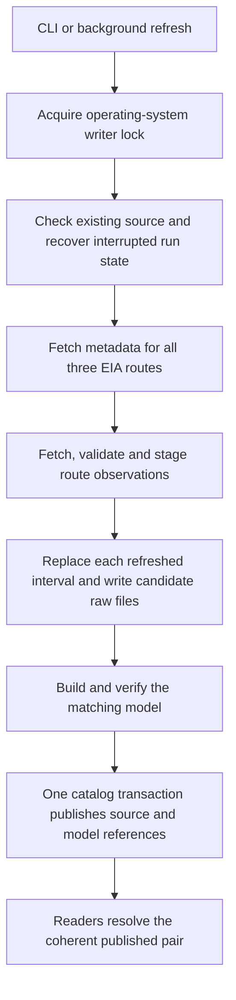
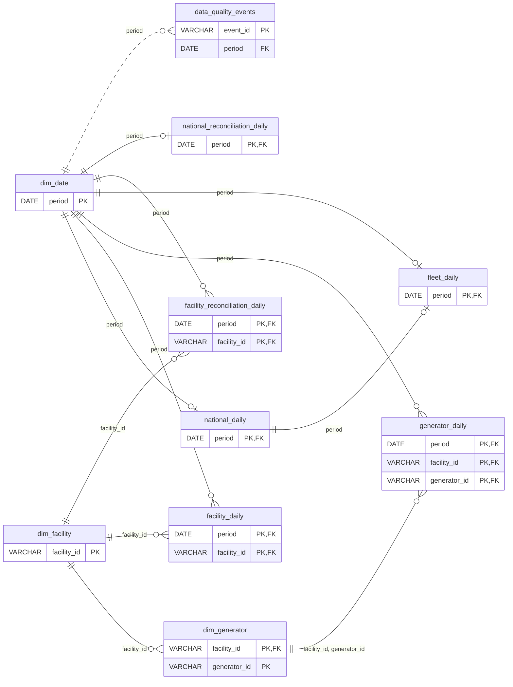

# From EIA observations to a published analytical model

Outage Explorer downloads daily nuclear-outage observations, preserves what the source reported, and builds tables that make the fleet percentage and data-quality checks reproducible. The main safety rule is simple: prepare and validate the new files first, then publish the matching source snapshot and model together. Readers keep the previous valid pair if preparation fails.

Start with the [project tour](PROJECT_TOUR.md) for the repository and tools. This guide explains the data path and its exact contracts; [data findings](FINDINGS.md) shows what the retained observations actually establish. Use [local operations](LOCAL_OPERATIONS.md) for setup and recovery, [design rationale](DECISIONS.md) for alternatives, and [verification records](NOTES.md) for dated checks. The [API contract](API_CONTRACT.md), [query security](QUERY_SECURITY.md) and [browser workspace](BROWSER_WORKSPACE.md) explain how people access the model.

## Start with the terms

**EIA** is the U.S. Energy Information Administration, the provider of the three daily API routes used here. An **API route** is a named address from which the program requests one kind of observation. EIA/NRC-reported outage and capacity describe reported status and capacity; they do not measure how much electrical energy was generated over a day.

A dataset's **grain** says what one row means. Here a row describes one national date, one facility on a date, or one generator within a facility on a date. These are three independent source observations. Adding generator rows is a useful check against a published facility value; it does not turn the sum into the original facility observation.

A **natural key** identifies an observation using its real fields, such as date plus facility ID plus generator ID. A **primary key (PK)** is the model's declared row identity. A **foreign key (FK)** declares which key in another dataset an identity must match. A **fact** stores an observation or measure; a **dimension** describes an identity or date for joining and explanation.

**Parquet** is the typed, compressed, column-oriented file format holding the analytical data. Unlike plain CSV, it retains column types and lets an engine read selected columns and use file statistics. **DuckDB** is the embedded SQL engine used by trusted Python ingestion, transformation and report code; it needs no separately managed database server. **SQLite** is a different embedded database: `data/catalog.sqlite3` records run history and which immutable source/model files are published. The catalog is not the store for the millions of analytical facts. The web application's separate `.service/web.sqlite3` stores accounts, sessions and application state; see the project tour for that distinction and SQLite WAL/SHM helper files.

A **snapshot** is a retained source-data version. A **model bundle** is the set of facts, dimensions, reconciliation tables and quality events built from one snapshot. A **manifest** is the JSON description of a bundle: identities, schemas, counts, provenance, hashes and contracts. A **checksum/fingerprint** is a digest used to detect changed content. It checks consistency with retained evidence; it cannot establish that the upstream provider is correct.

## Follow one refresh from request to publication



“Publish” means changing the catalog references that readers use. Creating a newer directory is insufficient. Only after the source and model files are ready does the catalog advance; this is the difference between an unpublished candidate and current data. The separate background refresh job then records its application-level completion in `.service/web.sqlite3`. That is a separate transaction: an interrupted job record does not prove that no data was published.

The transformation code is described as “pure” in the sense that it receives pinned sources rather than choosing current data, reading credentials or publishing. It still performs filesystem and DuckDB work. Trusted native DuckDB transformations are separate from user SQL, which uses the disposable compiler and BUFFER-only DuckDB-WASM/Node worker described in [query security](QUERY_SECURITY.md).

## Preserve source identity and exact values

[domain.py](../src/outage_explorer/domain.py) defines the source contract:

| Source grain | EIA route | Natural key |
| --- | --- | --- |
| National | `us-nuclear-outages` | `period` |
| Facility | `facility-nuclear-outages` | `period, facility` |
| Generator | `generator-nuclear-outages` | `period, facility, generator` |

Raw columns include `period` as `DATE`; `facility`, `facilityName` and `generator` where relevant; `capacity`, `outage` and `percentOutage` as `DECIMAL(24,9)` with their source-unit columns; and `_source_row`, `_row_hash`, `_quality_flags` for retained evidence. `DECIMAL(24,9)` means up to 24 total digits, including 9 fractional digits. Identifiers remain nonempty trimmed strings, including leading zeros. Generator `1` in one facility is a different identity from generator `1` in another. Names can change and are not join keys. Capacity remains a daily fact because the denominator changes over time.

The validator accepts decimal strings, integers, nulls and empty measures. It rejects booleans, binary floating-point inputs, nonfinite or unrepresentable numbers, fractional-precision loss and values outside the numeric/input-length envelopes. Required fields, actual ISO calendar dates, requested date bounds and expected units must match. Unusual finite measures remain visible with quality flags when they fit the contract.

Missing required fields or incompatible units/types fail; additive fields are preserved in sanitized canonical source JSON and reported as schema drift. Do not describe this as rejecting every added field. Validation errors name fields without echoing untrusted source values or credentials.

Each row has a SHA-256 hash of that canonical, sanitized source JSON. Identical natural-key/hash duplicates collapse; different hashes at the same natural key fail. A name or additive-field change can therefore count as a changed observation even when capacity and outage are unchanged. Idempotence means equivalent logical content after a rerun, not identical generated bundle IDs or timestamps.

## Fetch complete pages without trusting a misleading total

[eia.py](../src/outage_explorer/eia.py) fixes the API host and supported routes; it is not a general-purpose URL fetcher. Metadata validation checks advertised start/end dates, daily frequency, required measures/units and entity facets before data extraction starts.

The client requests at most **5,000 rows per page**, sorted ascending by every natural-key column. It advances the offset by the actual returned row count, continues after short pages, and requires an empty terminal response. The provider's `response.total` is provenance rather than a loop bound. Repeated page hashes and repeated first/last-key boundaries are errors; a maximum-page safety limit prevents an endless loop. The observed facility-total discrepancy behind this choice is recorded in [data findings](FINDINGS.md#what-the-november-inspection-confirmed).

Network errors, HTTP 429 and HTTP 5xx are retryable; permanent credential errors are not. Defaults are a **30-second request timeout** and **three additional attempts**, with bounded exponential backoff plus jitter. Seconds-based and date-based `Retry-After` values are honored. Excessive waits become typed errors with `retry_at`, allowing an operator to retry later. One shared limiter spaces request starts across route workers and retries; 429 cooldown is shared, so more workers do not bypass the policy. The rate lock is not held during network work.

Responses have a byte limit; invalid JSON/shape and error payloads embedded in HTTP 200 are rejected. Redirects are refused so the query-string API key is not forwarded. Recursive sanitization removes named secret fields, key-bearing URLs and known credential canaries from text, mapping keys and nested values before content leaves the client.

The standard-library HTTP client keeps dependencies small, at the cost of implementing richer pooling, asynchronous transport and telemetry separately. Up to three route workers overlap latency; pages for one route remain sequential. Per-request timeouts and page caps are not a strict whole-run deadline. Cancellation is cooperative between pages; a request already executing can last until its timeout. Sorting, boundary guards and confirmation reduce risk without creating a simultaneous upstream snapshot. The manifest states the precise guarantee: **“EIA is live; local publication is atomic, source pages are not a transaction.”**

## Replace the correction window, then rebuild the complete model

[pipeline.py](../src/outage_explorer/pipeline.py) calculates route-specific bounds. A first `recent` ingest backfills from metadata's earliest date. A later `recent` ingest starts at that route's watermark minus **29 days**, giving a **30-day overlap**. An optional requested end is bounded by the route's metadata end. A regression in the provider's advertised coverage fails rather than silently shrinking stored history.

An unbounded `full` ingest replaces all source history. `recent` and bounded `full` refreshes retain prior rows outside the requested interval and replace the **entire interval** with newly extracted observations. This handles additions, revisions and deletions rather than merely appending. If rows would be deleted, a second independently paginated extraction must produce the same ordered logical digest before acceptance. Two matching extractions can still share an upstream omission; confirmation is a consistency safeguard rather than proof of upstream completeness.

An entirely empty route fails. Missing source-advertised boundary dates also fail as possible truncation. Interior gaps survive as inspectable source anomalies. A correction older than the overlap remains undetected until a broader or full refresh; [test_pipeline_failures.py](../tests/test_pipeline_failures.py) includes that case.

This is **incremental extraction**, not incremental analytical materialization. The refreshed raw datasets are rewritten after interval replacement, and the complete analytical model rebuilds. A future incremental model would have additional invalidation responsibilities, described below.

## Make publication and crash recovery explicit

[storage.py](../src/outage_explorer/storage.py) uses a nonblocking operating-system writer lock: Windows byte-range locking or POSIX `flock`. Process death releases ownership. The persistent lock file can remain, so its existence alone does not mean another writer owns the lock. Equivalent POSIX runtime acceptance remains unverified in the recorded delivery.

The data catalog enables SQLite WAL mode, `synchronous=FULL` and foreign keys. It stores runs, raw snapshots, model builds, model snapshots and separate singleton source/model publication references; a unique active-run index prevents concurrent running records. Catalog initialization also creates `.staging`, `.model-staging`, `snapshots`, `models` and `runs`. Empty staging directories are expected when no candidate is being prepared; their existence is workspace structure, not missing published data.

Candidate files and manifests are closed and synchronized before immutable rename. The sequence is raw candidate rename, matching model preparation/verification, then `Catalog.publish`:

1. Validate identity, disk manifest, physical files and model-source binding.
2. Begin the SQLite write transaction (`BEGIN IMMEDIATE`).
3. Recheck that the parent source is still current and the run is active.
4. Register the raw snapshot and update its reference.
5. Register the matching model and update its reference.
6. Mark the ingestion run succeeded and commit once.

A model insertion/commit failure rolls back the raw reference as well. A legacy raw-only publication invalidates the model reference rather than making an old model appear current for new raw files. Readers resolve the coupled references together and reject a mismatch. A standalone model build pins its source; publication fails as stale if that source changed before commit.

Recovery runs only while holding the writer lock. It marks still-running work interrupted; it does not downgrade committed success. `fail_run` also updates only running records, so a late diagnostic/reporting error cannot overwrite a committed success. The catalog transaction is the atomic point, not one transaction covering all filesystem writes. Before commit, a crash can leave staging or immutable candidate directories that are not current. Recovery does not discover and promote those directories. Automatic orphan cleanup and reference-aware retention are not implemented.

[Crash-recovery tests](../tests/test_crash_recovery.py) terminate real child processes after raw rename, model rename and the joint catalog commit. Their recorded results verify the old pair before commit and the new pair after commit, plus lock release and recovery. These tests are stronger evidence than mocked exceptions alone, but they do not establish universal power-loss durability: portable directory `fsync` is unavailable on Windows and guarantees depend on the operating system/filesystem.

## Daily datasets and their relationships

| Dataset | One row represents | Primary key |
| --- | --- | --- |
| `dim_date` | A date observed in at least one source grain | `period` |
| `dim_facility` | A facility identity observed in either detail route | `facility_id` |
| `dim_generator` | A generator identity within its facility | `facility_id, generator_id` |
| `national_daily` | A published national observation for a date | `period` |
| `facility_daily` | A published facility observation for a date | `period, facility_id` |
| `generator_daily` | A published generator observation for a date | `period, facility_id, generator_id` |
| `fleet_daily` | The versioned national offline-capacity metric for a date | `period` |
| `facility_reconciliation_daily` | A facility/date observed in the facility route or its generator aggregate | `period, facility_id` |
| `national_reconciliation_daily` | A date observed in any source grain | `period` |
| `data_quality_events` | A deterministic review event for an observed date/entity/rule | `event_id` |

Identifiers are `VARCHAR`. A generator named `1` at one facility differs from generator `1` at another. Names are descriptions, never join keys. Facts retain observation-time facility names. `dim_facility.facility_name` is the latest non-null observed name; same-date ties prefer the facility route, then deterministic name ordering. This is a current descriptive dimension, not a slowly changing history. Future ownership/name history should use an explicit temporal dimension rather than overwrite historical facts.

Facility identities are the union of both detail routes. This preserves a generator whose facility-day parent is absent. `generator_daily` references `dim_generator`, **not** `facility_daily`: an FK to the latter would reject the coverage anomalies reconciliation must expose. National reconciliation references the date dimension and can exist without a national source row. Observed first/last dates do not assert commissioning or retirement dates.

The diagram shows every declared PK/FK and omits non-key attributes for readability. The complete column reference follows below. The diagram source is [ER.mmd](ER.mmd).



Before publication, primary keys are checked for uniqueness and non-null values, and each declared FK is checked with an anti-join. These are executable model constraints; standalone Parquet files do not enforce relational constraints. Catalog metadata exposes the same keys to consumers.

`dim_date` is the union of observed source dates, not proof that every calendar date or entity is present. Complete-calendar queries must explicitly generate/join that calendar and preserve missing observations. Interior-gap events detect missing dates between observations without manufacturing facts or asserting membership before an entity's first or after its last observation.

## Calculating the fleet percentage

`fleet_daily.offline_share` is the fraction of published national capacity reported offline on a date:

```text
ratio = national_daily.outage_mw / national_daily.capacity_mw
offline_share = quantize(ratio, 12 decimal places)
offline_pct = quantize(100 * ratio, 9 decimal places)
reported_vs_calculated_pct_gap = reported_outage_pct - offline_pct
```

The metric definition remains version **1**. Both outputs use the unrounded ratio and Python `Decimal`, precision **28**, **`ROUND_HALF_UP`**. `offline_pct` is not calculated from the already quantized share. Storage types are `DECIMAL(24,12)` for the share and `DECIMAL(24,9)` for the percentage. On September 3, 2026, 1,507.338 MW / 97,620.5 MW yields share `0.015440793686`, calculated percent `1.544079369`, and separately preserved reported percent `1.540000000`.

Null/non-positive capacity or null outage makes both derived outputs null and adds `metric_undefined`. Source flags remain visible. Finite out-of-range values are preserved with flags rather than clipped into 0–100%, provided the source and derived values fit their declared decimal contracts. The 91 Indian Point zero-capacity observations remain in the base facts despite not supporting a valid ratio.

The numeric storage envelope is deliberate. For example, capacity `0.000000001` MW and outage `10000` MW each fit a source `DECIMAL(24,9)`, but their share `10000000000000` exceeds `DECIMAL(24,12)`. A derived overflow or inability to quantize at the specified Decimal precision fails the complete candidate build with `invalid_model`; neither publication pointer advances. It is not converted to zero, infinity, a clipped percentage or an apparently ordinary null. The prior valid raw/model pair remains available. Supporting a wider numerical envelope requires an explicit schema/metric-contract review, rather than silently changing historical types. Source validity alone does not guarantee that every derived expression is representable.

The metric describes **EIA/NRC-reported offline capacity**, not energy generated, daily MWh loss or capacity factor. Daily reported capacity/status is not an integral of electricity output. Show the numerator, denominator and observation date. [EIA capacity and generation definitions](https://www.eia.gov/tools/faqs/faq.php?id=101&t=3).

```sql
SELECT period, capacity_mw, outage_mw, offline_share, offline_pct,
       reported_outage_pct, reported_vs_calculated_pct_gap, quality_flags
FROM fleet_daily
WHERE period BETWEEN DATE '2026-09-01' AND DATE '2026-09-30'
ORDER BY period;
```

A combined-period summary uses `SUM(outage_mw) / SUM(capacity_mw)` over the intended observed daily population, not summed percentages or an unweighted average of generator percentages. This is a capacity-day weighted share, not MWh loss; missing dates require an explicit coverage assessment.

## Comparing grains and detecting review events

Observed generator sums are compared to published facilities; facility and generator sums are separately compared to published national values. Full outer joins preserve missing parents and children. Counts and null counts accompany aggregates. If any contributing measure is null, that measure's aggregate is null; `SUM` cannot hide it. An absent aggregate has count zero and null measures rather than zero MW.

All model MW gaps are **child aggregate minus published parent**. Absolute-gap columns retain magnitude alongside direction. A facility reported-percentage gap is its capacity-weighted generator reported percentage minus its own reported percentage. National percentage gaps compare each child grain's capacity-weighted published percentages to the national reported percentage. These preserve rounding effects while the fleet metric independently uses MW measures.

| Diagnostic | Values and policy |
| --- | --- |
| `coverage_status` | `both_observed`, `missing_parent`, `missing_children`, `null_measure` |
| `mw_comparison_status` | `exact` at zero; `within_tolerance` when every absolute gap is ≤0.01 MW; otherwise `mismatch`; `undefined` when a required gap is null |
| `pct_comparison_status` | `exact`; `within_rounding_tolerance` at ≤0.005 percentage points; `mismatch`; `undefined` |
| Weighted reported percentage | `SUM(child_capacity_mw * child_reported_pct) / SUM(child_capacity_mw)`; requires every capacity/percentage and a positive denominator; quantized to 9 places with `Decimal`, precision 28, `ROUND_HALF_UP` |

Tolerances are review policies, not permission to alter source values; exact nonzero gaps remain available. The independent [reconciliation SQL](../src/outage_explorer/sql/reconciliation.sql) tests rounding with scaled integers before division. A rounding-compatible percentage difference need not imply an MW mismatch. Decimal facts and totals avoid binary floating-point classification errors.

Quality events are review warnings and never establish a physical cause:

| Rule | Trigger |
| --- | --- |
| `zero_capacity` | Capacity equals zero |
| `zero_capacity_positive_reported_pct` | Capacity equals zero and reported percentage is positive |
| `source_<flag>` | A preserved source flag, including `source_capacity_non_positive` |
| `entity_coverage_gap` | Same-identity observations are more than one calendar day apart; `gap_days` counts intervening missing days |
| `capacity_change` | Consecutive calendar-day observations, positive previous capacity, absolute change ≥100 MW **and** relative change ≥10% |
| `missing_parent` / `missing_children` | Facility reconciliation lacks the corresponding source parent or child aggregate |

IDs hash the rule, date, grain, facility, generator and previous date, keeping equivalent events stable across rebuilds. Smaller capacity changes remain queryable in facts: Grand Gulf's 273 MW step meets the rule, while Peach Bottom's 82 MW example is below it. Source coverage may be incomplete when every grain sum agrees, as [Data findings](FINDINGS.md) demonstrates with River Bend.

## Storage layout, fingerprints and model versions

```text
data/
  snapshots/<source_id>/
    national.parquet, facility.parquet, generator.parquet, manifest.json
  models/<model_id>/
    <dataset_id>.parquet  # one file per registered dataset
    manifest.json
  catalog.sqlite3
```

Each immutable bundle writes one file per dataset, sorted by its PK, with **ZSTD** compression and target row groups of **122,880 rows**. Daily facts sort by date first, enabling date-filter pruning through row-group statistics; dimensions sort by identity. DuckDB can project needed columns without loading entire files into application memory.

Version 2 deliberately avoids year/entity directory partitions. The raw snapshot measured in the retained inspection is approximately **46.388 MB** in total: national 0.447 MB, facility 17.745 MB, generator 28.196 MB. Annual or facility partitions would create many small files and metadata/open overhead. A guideline such as 100 MB per partition is a sizing heuristic, not a reason to split this small dataset. Revisit annual partitions after measured growth and representative date-filter benchmarks demonstrate a benefit. Retain date/key sorting and avoid a collection of roughly 1 MB files; row groups already provide a pruning unit at this scale.

Manifests record byte-level SHA-256 checksums. Model datasets also have a logical SHA-256 over canonically encoded typed rows in PK order, supporting rebuild comparison when a writer version changes physical Parquet bytes. Decimals use fixed-point encoding for the fingerprint. The model manifest records schemas, keys, units, classifications, date bounds, counts, source file bindings, metric definitions, rule counts and storage policy.

Ingest builds and verifies a model for its candidate source before publication. SQLite publishes source and model pointers in **one transaction**. Failure leaves the previous pair available. A standalone build pins the current source and can publish only if it is still current at commit; otherwise it fails as stale. Readers resolve coupled pointers together and reject mismatches. Historical immutable bundles and build history remain available.

Column types, identity, metric semantics and source-unit changes require an explicit model-version decision. Missing required fields, incompatible types or units and precision loss fail validation; additive source fields are preserved and tracked.

Model version **2** corrects catalog unit labels: absolute percentage values use `percent`, while differences use `percentage points`. The numeric observations, schemas and fleet metric formula are unchanged. The development version 1 contract is frozen in [model-v1.json](../src/outage_explorer/contracts/model-v1.json); its immutable artifacts remain readable with an explicit warning about the old metadata labels. Historical metadata is preserved under its original contract rather than rewritten as the current contract. The fleet metric definition stays at version **1** because its numerical meaning has not changed.

## What the current design costs, and when to change it

The current implementation favors complete verification at the measured 1.16-million-observation volume. It uses a staging DuckDB database with one thread and a configured 256 MB engine memory limit, 8,192-row Python batches, sorted ZSTD files and persisted reconciliation/quality results. The engine setting is not a hard process-RSS limit, and batching does not make every sort or aggregation memory-free. Full rebuilds, ordered logical hashing and repeated file integrity checks still process the complete relevant datasets. JSON evidence reports currently accumulate their result rows in Python. These costs are explicit limits of this delivery.

The following are proposed changes, to be selected through measurement rather than claimed as implemented:

| Trigger / workload | Change to evaluate | Benefit and cost |
| --- | --- | --- |
| Date-filtered scans grow beyond acceptable latency | Partition large daily facts by year; consider months only when their measured file sizes justify it. Retain date/key sorting and compact small outputs | Prunes irrelevant files, but adds file/metadata operations and cross-partition query complexity. Avoid partitioning by facility or generator unless benchmarks justify the many small files |
| Repeated queries or join-heavy trusted reports dominate | Compare direct Parquet scans with a disposable/materialized DuckDB read model | May improve repeated work and join planning, but consumes another data copy and introduces a rebuild/invalidation responsibility |
| Refresh spends most time rebuilding unchanged history | Rebuild changed date/entity partitions and reference unchanged immutable files from the new manifest | Saves I/O, but must invalidate national/facility aggregates, latest-name dimensions and previous/next entity observations used by gap/change rules. A correction or deletion can affect both sides of a partition boundary |
| Hashing, reporting or staging consumes the operating budget | Measure bytes read/written, peak RSS, spill size, build duration and filtered/full-history latency. Stream large report outputs and reserve bounded temporary disk | Makes the actual bottleneck visible; adds operational limits and cleanup/recovery work. Do not remove integrity checks merely to improve a benchmark |
| Retained versions consume the disk budget | Add reference-aware retention and off-machine backup with a tested restore | Bounds storage, but must preserve published, pinned-analysis and in-use versions. An immutable file is not a backup |
| Concurrency or scale exceeds a single-machine service | Evaluate a shared transactional catalog and private object storage, with separately bounded analytical workers | Separates operational and analytical capacity, but adds latency, network failure modes and deployment/authorization complexity |

A multi-file model is a storage-contract migration: today's adapter intentionally accepts exactly `<dataset_id>.parquet`. A future manifest must enumerate and checksum the authorized files for one version; a broad directory glob must never combine historical generations. Publication must still advance the source/model references atomically, and old contracts must remain readable. Incremental output must be compared against a full rebuild, including corrected/deleted observations and quality events spanning partition boundaries.

For representative benchmarks, compare a 30-day fleet query, a 30-day facility filter, full-history reconciliation and an overlap refresh. Record correctness parity as well as latency, RSS, temporary disk and bytes read; no larger-volume throughput target has been measured here. Part 3's isolated user-query runtime additionally has a whole-file transfer and input-size budget, so making model files larger does not automatically make them usable through that endpoint.

DuckDB documents projection/filter pushdown for Parquet, row-group/file-size trade-offs, and cases where a materialized database can help repeated or join-heavy workloads. These support the options above; they do not establish their benefit for this project's unmeasured future workload. [Parquet reading](https://duckdb.org/docs/2.0/data/parquet/overview), [file-format performance](https://duckdb.org/docs/2.0/guides/performance/file_formats), [workload tuning](https://duckdb.org/docs/2.0/guides/performance/how_to_tune_workloads).

### Measured files and remaining resource limits

The November 2, 2026 UTC inspection recorded these largest model files. The recorded ten-model-file total was 44,086,438 bytes. These are dated observations, not size guarantees for later refreshes.

| Dataset | Bytes |
| --- | ---: |
| `generator_daily` | 25,901,575 |
| `facility_daily` | 16,056,086 |
| `facility_reconciliation_daily` | 1,237,130 |
| `national_daily` | 340,554 |
| `national_reconciliation_daily` | 310,410 |
| `fleet_daily` | 188,706 |
| `data_quality_events` | 30,312 |

Full scans, sorts and repeated physical/logical hashing grow with the complete relevant data. In addition to the DuckDB engine limit, process RSS (resident memory), Python memory and spill disk must be measured. `_fleet` and national reconciliation use `fetchall`/Python lists; `_events` accumulates events in a dictionary; `reports.py` accumulates every result row despite batched fetching. These are specific limits, not a claim of constant-memory processing.

There is no authoritative dated expected-reactor inventory, upstream snapshot transaction/historical-revision guarantee, automatic orphan cleanup, reference-aware retention or off-machine restore guarantee. Local locks and SQLite coordinate this single-machine design rather than multiple hosts. Off-machine backup/restore, large-volume performance and a shared catalog/object-store deployment remain future work; immutable files alone are not a backup.

## Verify a bundle, and understand what verification cannot prove

The executable model contract is [model_contracts.py](../src/outage_explorer/model_contracts.py); transformations are in [modeling.py](../src/outage_explorer/modeling.py). The model manifest binds the exact contract, source files, checksums and metric version. Dates use ISO encoding and Decimal values fixed-point encoding for logical hashes.

`verify_model` in [model_store.py](../src/outage_explorer/model_store.py) checks the supported/frozen contract version, manifest identity, exact dataset set, exact schemas, semantic catalog metadata, physical and ordered logical hashes, PK/FK validity, source row-count bindings, and an independent recomputation of the official fleet metric. It does **not** independently rederive every reconciliation and quality-event rule from raw data. Those algorithms also need independent queries and meaningful tests. Valid hashes can describe an internally consistent bug; they do not prove upstream truth.

`register_views` accepts only caller-approved datasets, resolves exact manifest filenames and verifies file checksums. Its `open_model_connection` is for trusted application SQL. Authorization and hostile SQL containment are separate concerns described in [query security](QUERY_SECURITY.md).

### Where the relevant tests exercise the contract

This is a coverage/navigation reference, not a claim these tests ran during the documentation rewrite. Dated versions, results and the unresolved timeout test belong in [verification records](NOTES.md).

| Test module | Cases represented |
| --- | --- |
| [test_eia.py](../tests/test_eia.py) | Metadata drift, wrong totals/short pages, repetition, complete-key sorting, 429/date Retry-After, excessive waits, 5xx/network exhaustion, response bytes, sanitization, shared thread limiter |
| [test_domain.py](../tests/test_domain.py) | Leading-zero IDs, exact decimals, nulls, units, unsupported floats, precision loss, safe errors, additive fields and outlier retention |
| [test_pipeline.py](../tests/test_pipeline.py) | Typed output, equivalent logical reruns, interval replacement/deletion, conflicting duplicates, parent corruption, confirmation disagreements and reporting failures |
| [test_pipeline_failures.py](../tests/test_pipeline_failures.py) | Missing boundaries, empty routes, atomic-publication faults, revisions older than overlap, metadata regression and additive-field retention |
| [test_crash_recovery.py](../tests/test_crash_recovery.py) | Real process death after raw rename, model rename and catalog commit |
| [test_modeling.py](../tests/test_modeling.py) | National formula, no double rounding, invalid denominators, composite identities, missing parents, observation names, null totals, signed gaps, weighted percentages, reproducible events and logical rebuild equality |
| [test_model_publication.py](../tests/test_model_publication.py) | Coupled rollback, derived-share/quantization overflow, stale source, binding drift, legacy raw-only invalidation and matching active build |
| [test_model_store.py](../tests/test_model_store.py) | Physical/manifest tampering, semantic forgery, independently wrong metric, Viewer catalog scope and frozen old contracts |
| [test_reports.py](../tests/test_reports.py) | Packaged SELECT-only statements, known parameters, signed-gap fixtures, exact decimal serialization and minimum calendar window |

[Recorded fixtures](../tests/fixtures/recorded/README.md) contain first pages, not full-route replays. Some empty terminal pages are explicitly synthetic. The real response-recording run failed before publication. These fixtures demonstrate protocol/domain compatibility rather than a complete successful live ingest or every upstream pagination behavior.

## Inspect metadata and reproduce trusted reports

`national_daily` and `fleet_daily` have classification `national`, available to Viewer, Analyst and Admin. The other eight datasets have classification `detail`, available to Analyst and Admin. `model catalog --persona viewer|analyst|admin` chooses corresponding metadata for a local CLI inspection. Selecting a persona is not authentication. The implemented HTTP service derives the role from trusted identity and authorizes every named dataset before analytical I/O; the Admin additionally has refresh permission. See the [API contract](API_CONTRACT.md) for routes and [query security](QUERY_SECURITY.md) for enforcement.

From the repository root, with the environment already installed as explained in [local operations](LOCAL_OPERATIONS.md), these commands use local snapshots and need no EIA key. `model build` writes a new model; the other inspection/report commands serve different purposes, so choose the one needed.

```powershell
.\.venv\Scripts\python.exe -m outage_explorer model status --data-dir data
.\.venv\Scripts\python.exe -m outage_explorer model verify --data-dir data
.\.venv\Scripts\python.exe -m outage_explorer model catalog --data-dir data --persona analyst
.\.venv\Scripts\python.exe -m outage_explorer model history --data-dir data --limit 10
.\.venv\Scripts\python.exe -m outage_explorer model report --data-dir data --model-id e5721cad365d47beb0a8a322199a3138 --start 2026-09-01 --end 2026-09-30 --output work/part2-demo-report.json
.\.venv\Scripts\python.exe -m outage_explorer model build --data-dir data
```

The explicit historical model ID reproduces the retained [findings](FINDINGS.md) when that bundle is available. Omitting it uses the currently published model. A fresh clone has no local data/key; ingestion produces different IDs and can observe later source revisions. The report's `work/` output path is scratch output created by a future command. [Engineering notes](NOTES.md) describe the recorded verification scope; private verification receipts are not required inputs; the selected model bundle and its referenced data must be present.

[reports.py](../src/outage_explorer/reports.py) loads **18 named application-owned statements** from [reconciliation.sql](../src/outage_explorer/sql/reconciliation.sql) and [part2_findings.sql](../src/outage_explorer/sql/part2_findings.sql). It validates that each is one SELECT and uses only known bound date parameters. Reconciliation requires at least **30 inclusive calendar days**. Historical anomaly probes intentionally use their stated dates; supplied start/end do not filter every query. Results include query hashes, columns, rows, counts, model/source provenance and exact Decimal values serialized as strings.

The reconciliation asset contains calendar-aware daily national comparisons, daily facility comparisons, full-history summaries, exact percentage-rounding proof, a concrete percentage-gap example and actual discrepancy queries. The rounding proof uses scaled-integer cross-products before division, avoiding binary-floating-point ambiguity. Its identity is degenerate at zero capacity, so it cannot validate a reported percentage there. These are trusted report queries, separate from arbitrary user SQL isolation.

### Source-reading route

Read the functions in this order when tracing a correction or crash. Function names are navigation aids; line numbers change with edits.

| Step | Code |
| --- | --- |
| CLI command definitions/dispatch | [cli.py](../src/outage_explorer/cli.py); ingest dispatch constructs `EIAClient` |
| Source types and row contract | [domain.py](../src/outage_explorer/domain.py): `_measure`, `validate_row` |
| Metadata, pages and retry policy | [eia.py](../src/outage_explorer/eia.py): `fetch_metadata`, `iter_pages`, `_request_json`, `_acquire_request_slot`, `_one_request`, `_NoRedirect`, `sanitize` |
| Bounds, extraction and replacement | [pipeline.py](../src/outage_explorer/pipeline.py): `_bounds`, `_extract`, `_route`, `ingest` |
| Immutable model preparation | [model_store.py](../src/outage_explorer/model_store.py): `prepare_model`, `verify_model` |
| Model computations | [modeling.py](../src/outage_explorer/modeling.py): `logical_digest`, `_facts_and_dimensions`, `_fleet`, `_aggregates`, `_comparison`, `_reconciliation`, `_events`, `validate_model_tables`, `build_model` |
| Publication/recovery/reader resolution | [storage.py](../src/outage_explorer/storage.py): `writer_lock`, `Catalog.publish`, `publish_model`, `recover_interrupted`, `fail_run`, `current_model` |
| Trusted evidence reporting | [reports.py](../src/outage_explorer/reports.py): `report_queries`, `findings_report` |

## Complete column reference

`PK`/`FK` indicate membership in declared keys, including composite keys. Keys are non-null by validated contract; other columns may be null when an observation or comparison is unavailable. `DATE` is an observation date without an invented intraday timestamp. Base MW measures use `DECIMAL(24,9)`; aggregate MW totals/gaps use `DECIMAL(38,9)`; percentages and percentage-point gaps use `DECIMAL(24,9)`. Flags/details are canonical JSON in `VARCHAR`. `source_row_hash` links to the preserved source row. Exact FK tuples follow each dataset.

### `dim_date`

Union of observed source dates.

| Column | Type | Key | Unit |
| --- | --- | --- | --- |
| `period` | `DATE` | PK | — |
| `year` | `INTEGER` | — | — |
| `month` | `INTEGER` | — | — |
| `day` | `INTEGER` | — | — |

No foreign keys.

### `dim_facility`

Union of source identities; latest observed descriptive name.

| Column | Type | Key | Unit |
| --- | --- | --- | --- |
| `facility_id` | `VARCHAR` | PK | — |
| `facility_name` | `VARCHAR` | — | — |
| `first_observed` | `DATE` | — | — |
| `last_observed` | `DATE` | — | — |
| `seen_in_facility_route` | `BOOLEAN` | — | — |
| `seen_in_generator_route` | `BOOLEAN` | — | — |

No foreign keys.

### `dim_generator`

Generator identity is scoped to its facility.

| Column | Type | Key | Unit |
| --- | --- | --- | --- |
| `facility_id` | `VARCHAR` | PK, FK | — |
| `generator_id` | `VARCHAR` | PK | — |
| `first_observed` | `DATE` | — | — |
| `last_observed` | `DATE` | — | — |

Foreign key: `(facility_id)` → `dim_facility(facility_id)`.

### `national_daily`

Published national observations, without cross-grain substitutions.

| Column | Type | Key | Unit |
| --- | --- | --- | --- |
| `period` | `DATE` | PK, FK | — |
| `capacity_mw` | `DECIMAL(24,9)` | — | MW |
| `outage_mw` | `DECIMAL(24,9)` | — | MW |
| `reported_outage_pct` | `DECIMAL(24,9)` | — | % |
| `quality_flags` | `VARCHAR` | — | — |
| `source_row_hash` | `VARCHAR` | — | — |

Foreign key: `(period)` → `dim_date(period)`.

### `facility_daily`

Facility observations with observation-time names.

| Column | Type | Key | Unit |
| --- | --- | --- | --- |
| `period` | `DATE` | PK, FK | — |
| `facility_id` | `VARCHAR` | PK, FK | — |
| `facility_name` | `VARCHAR` | — | — |
| `capacity_mw` | `DECIMAL(24,9)` | — | MW |
| `outage_mw` | `DECIMAL(24,9)` | — | MW |
| `reported_outage_pct` | `DECIMAL(24,9)` | — | % |
| `quality_flags` | `VARCHAR` | — | — |
| `source_row_hash` | `VARCHAR` | — | — |

Foreign key: `(period)` → `dim_date(period)`.

Foreign key: `(facility_id)` → `dim_facility(facility_id)`.

### `generator_daily`

Preserved generator observations, including missing facility-day parents.

| Column | Type | Key | Unit |
| --- | --- | --- | --- |
| `period` | `DATE` | PK, FK | — |
| `facility_id` | `VARCHAR` | PK, FK | — |
| `generator_id` | `VARCHAR` | PK, FK | — |
| `facility_name` | `VARCHAR` | — | — |
| `capacity_mw` | `DECIMAL(24,9)` | — | MW |
| `outage_mw` | `DECIMAL(24,9)` | — | MW |
| `reported_outage_pct` | `DECIMAL(24,9)` | — | % |
| `quality_flags` | `VARCHAR` | — | — |
| `source_row_hash` | `VARCHAR` | — | — |

Foreign key: `(period)` → `dim_date(period)`.

Foreign key: `(facility_id, generator_id)` → `dim_generator(facility_id, generator_id)`.

### `fleet_daily`

US-08: share of published national fleet capacity offline each day.

| Column | Type | Key | Unit |
| --- | --- | --- | --- |
| `period` | `DATE` | PK, FK | — |
| `capacity_mw` | `DECIMAL(24,9)` | — | MW |
| `outage_mw` | `DECIMAL(24,9)` | — | MW |
| `reported_outage_pct` | `DECIMAL(24,9)` | — | % |
| `offline_share` | `DECIMAL(24,12)` | — | fraction |
| `offline_pct` | `DECIMAL(24,9)` | — | % |
| `reported_vs_calculated_pct_gap` | `DECIMAL(24,9)` | — | percentage points |
| `quality_flags` | `VARCHAR` | — | — |

Foreign key: `(period)` → `dim_date(period)`.

Foreign key: `(period)` → `national_daily(period)`.

### `facility_reconciliation_daily`

Observed generator sums versus published facility; absent/null is not zero.

| Column | Type | Key | Unit |
| --- | --- | --- | --- |
| `period` | `DATE` | PK, FK | — |
| `facility_id` | `VARCHAR` | PK, FK | — |
| `facility_name` | `VARCHAR` | — | — |
| `facility_present` | `BOOLEAN` | — | — |
| `generator_count` | `INTEGER` | — | — |
| `generator_null_capacity_count` | `INTEGER` | — | — |
| `generator_null_outage_count` | `INTEGER` | — | — |
| `generator_null_pct_count` | `INTEGER` | — | — |
| `facility_capacity_mw` | `DECIMAL(24,9)` | — | MW |
| `generator_capacity_mw` | `DECIMAL(38,9)` | — | MW |
| `facility_outage_mw` | `DECIMAL(24,9)` | — | MW |
| `generator_outage_mw` | `DECIMAL(38,9)` | — | MW |
| `capacity_gap_mw` | `DECIMAL(38,9)` | — | MW |
| `outage_gap_mw` | `DECIMAL(38,9)` | — | MW |
| `capacity_abs_gap_mw` | `DECIMAL(38,9)` | — | MW |
| `outage_abs_gap_mw` | `DECIMAL(38,9)` | — | MW |
| `facility_reported_pct` | `DECIMAL(24,9)` | — | % |
| `generator_weighted_reported_pct` | `DECIMAL(24,9)` | — | % |
| `reported_pct_gap_pp` | `DECIMAL(24,9)` | — | percentage points |
| `coverage_status` | `VARCHAR` | — | — |
| `mw_comparison_status` | `VARCHAR` | — | — |
| `pct_comparison_status` | `VARCHAR` | — | — |

Foreign key: `(period)` → `dim_date(period)`.

Foreign key: `(facility_id)` → `dim_facility(facility_id)`.

### `national_reconciliation_daily`

Published national values versus separately aggregated facilities/generators.

| Column | Type | Key | Unit |
| --- | --- | --- | --- |
| `period` | `DATE` | PK, FK | — |
| `national_present` | `BOOLEAN` | — | — |
| `facility_count` | `INTEGER` | — | — |
| `generator_count` | `INTEGER` | — | — |
| `facility_null_capacity_count` | `INTEGER` | — | — |
| `facility_null_outage_count` | `INTEGER` | — | — |
| `facility_null_pct_count` | `INTEGER` | — | — |
| `generator_null_capacity_count` | `INTEGER` | — | — |
| `generator_null_outage_count` | `INTEGER` | — | — |
| `generator_null_pct_count` | `INTEGER` | — | — |
| `national_capacity_mw` | `DECIMAL(24,9)` | — | MW |
| `facility_capacity_mw` | `DECIMAL(38,9)` | — | MW |
| `generator_capacity_mw` | `DECIMAL(38,9)` | — | MW |
| `national_outage_mw` | `DECIMAL(24,9)` | — | MW |
| `facility_outage_mw` | `DECIMAL(38,9)` | — | MW |
| `generator_outage_mw` | `DECIMAL(38,9)` | — | MW |
| `facility_capacity_gap_mw` | `DECIMAL(38,9)` | — | MW |
| `generator_capacity_gap_mw` | `DECIMAL(38,9)` | — | MW |
| `facility_outage_gap_mw` | `DECIMAL(38,9)` | — | MW |
| `generator_outage_gap_mw` | `DECIMAL(38,9)` | — | MW |
| `facility_capacity_abs_gap_mw` | `DECIMAL(38,9)` | — | MW |
| `generator_capacity_abs_gap_mw` | `DECIMAL(38,9)` | — | MW |
| `facility_outage_abs_gap_mw` | `DECIMAL(38,9)` | — | MW |
| `generator_outage_abs_gap_mw` | `DECIMAL(38,9)` | — | MW |
| `national_reported_pct` | `DECIMAL(24,9)` | — | % |
| `facility_weighted_reported_pct` | `DECIMAL(24,9)` | — | % |
| `generator_weighted_reported_pct` | `DECIMAL(24,9)` | — | % |
| `facility_reported_pct_gap_pp` | `DECIMAL(24,9)` | — | percentage points |
| `generator_reported_pct_gap_pp` | `DECIMAL(24,9)` | — | percentage points |
| `coverage_status` | `VARCHAR` | — | — |
| `mw_comparison_status` | `VARCHAR` | — | — |
| `pct_comparison_status` | `VARCHAR` | — | — |

Foreign key: `(period)` → `dim_date(period)`.

### `data_quality_events`

Reviewable source anomalies; flags do not establish physical causes.

| Column | Type | Key | Unit |
| --- | --- | --- | --- |
| `event_id` | `VARCHAR` | PK | — |
| `period` | `DATE` | FK | — |
| `grain` | `VARCHAR` | — | — |
| `facility_id` | `VARCHAR` | — | — |
| `generator_id` | `VARCHAR` | — | — |
| `rule_id` | `VARCHAR` | — | — |
| `severity` | `VARCHAR` | — | — |
| `previous_period` | `DATE` | — | — |
| `gap_days` | `INTEGER` | — | days |
| `before_capacity_mw` | `DECIMAL(24,9)` | — | MW |
| `after_capacity_mw` | `DECIMAL(24,9)` | — | MW |
| `outage_mw` | `DECIMAL(24,9)` | — | MW |
| `reported_outage_pct` | `DECIMAL(24,9)` | — | % |
| `details` | `VARCHAR` | — | — |

Foreign key: `(period)` → `dim_date(period)`.

The three daily source routes share the fixed base URL `https://api.eia.gov/v2/nuclear-outages/`. This is source provenance, not a configurable request destination.
