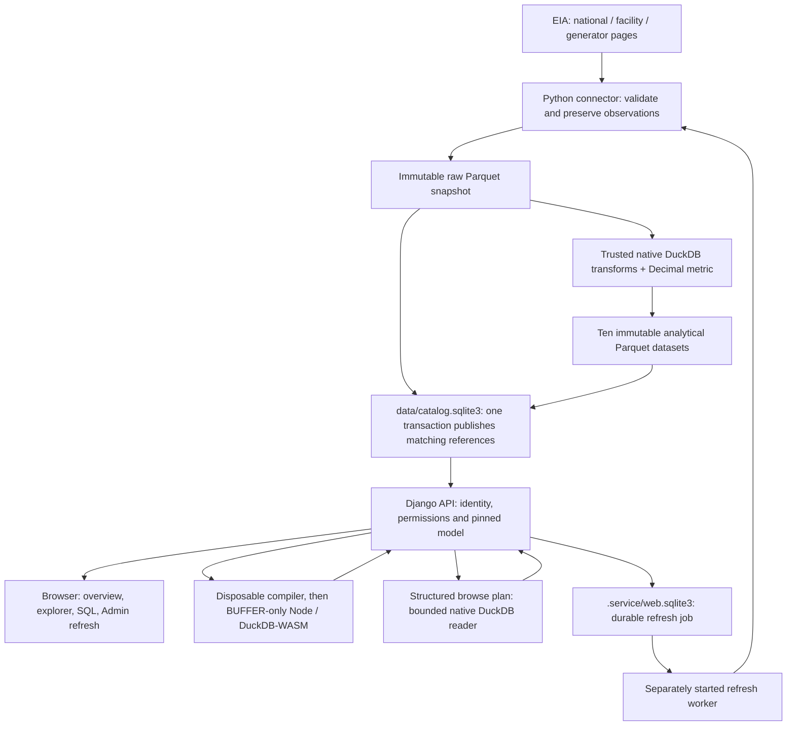

# Understand Outage Explorer: the product, files and moving parts

Outage Explorer answers a practical question: **how much of the U.S. nuclear fleet's reported capacity was offline on a given day, and can we trust the observations behind that answer?** It downloads published observations, keeps reproducible local versions, compares three levels of detail, and gives authenticated users a browser and SQL workspace.

Read this guide first. Continue with [the data pipeline and model](DATA_PIPELINE_AND_MODEL.md), then [the actual findings](FINDINGS.md). Use [local operations](LOCAL_OPERATIONS.md) when you want commands. The [repository guide index](../README.md) explains the rest of the reading path.

## Start with the people and questions

| Person | What the product lets them do | Challenge stories |
| --- | --- | --- |
| Viewer | Follow national trends; preview/query only `national_daily` and `fleet_daily` | US-02, US-04, US-05 |
| Analyst | Discover all ten datasets, filter/preview them and write supported SQL | US-01 through US-05, US-07, US-08 |
| Admin | Analyst capabilities plus request a refresh and inspect their own jobs | US-06 |

The **EIA**, the U.S. Energy Information Administration, publishes the API data. An API is a programmatic interface: the connector requests pages of JSON observations rather than asking a person to export spreadsheets. Here all three routes are daily. Their **grain** means what one row represents: one national day, one facility on a day, or one generator within a facility on a day. A generator is an individual unit; its ID is only unique within its facility.

Capacity and outage are reported in **MW**, a measure of power. The ready-made metric is the same day's national outage MW divided by national capacity MW. It describes offline capacity, not electricity generated or daily energy lost. The model keeps both operands and uses explicit decimal rounding. It never averages unweighted generator percentages.

The challenge has four connected parts: connector, analytical model, secure backend and browser. [Decisions](DECISIONS.md), [findings](FINDINGS.md) and [engineering notes](NOTES.md) document the implementation and its evidence. [Browser product choices](BROWSER_WORKSPACE.md#why-these-product-choices-fit-this-version) explain the added stories, exclusions and priorities. The [repository README](../README.md) is the guide index.

## Follow one observation through the system



**Raw snapshot** means the three validated source datasets, retaining sanitized source values and provenance. **Analytical model** means the ten datasets built from that snapshot: dimensions for identities/dates, three daily facts, fleet metric, two reconciliation tables and quality events. A fact is an observation or measure at a defined grain; a dimension describes an identity. Capacity belongs in daily facts because it changes over time.

**Parquet** is the typed, compressed column-based file format holding analytical rows. **DuckDB** is the SQL engine reading/writing it. **SQLite** is the small transactional database recording operational state. These are different roles, not three competing copies of the same database.

The connector writes and verifies new files before publishing them. One transaction in the data catalog advances matching raw/model references. Existing files are immutable: readers can keep their old version. Unfinished candidates may remain; recovery neither promotes them by directory discovery nor automatically removes them. This is coherent local publication, not a power-loss or backup guarantee; EIA's changing pages are not an upstream transaction. Recent extraction replaces a 30-day overlap and can miss older revisions. It still rebuilds the full analytical model.

Refresh has one additional boundary: after publishing data, the worker completes its job in the separate application database. A crash between those transactions can leave new published data and an interrupted job. Check publication history before assuming an interrupted refresh changed nothing.

## Follow one user query

Django is the Python web framework handling login, sessions, CSRF protection and HTTP. CSRF checks browser tokens and request origin to help prevent another site causing unwanted actions, including at login before authentication. The server derives the persona; a browser field or Django staff flag cannot grant product access.

The SQL service authorizes the selected dataset, then a bounded disposable Python compiler turns submitted SQL into checked/regenerated SQL. It discovers **every named table** and validates a deliberately small SELECT language. Each table is authorized before analytical I/O, even inside a query shape that will later be rejected. The engine receives only the selected checksummed Parquet bytes. A disposable Node process runs DuckDB-WASM with buffer-only capabilities, followed by a fresh persisted identity/session check before results are delivered or cached. Explore instead submits typed search/filter/order specifications to a separate bounded native reader. It applies them across the whole selected dataset and returns a seek page without buffering the full file in WASM or the browser. Both paths share admission, pinned versions and final authorization checks.

There are four distinct protections: identity/permissions decide **which data**; the SQL language policy decides **which expressions**; engine capabilities decide **which files/network operations are possible**; resource limits bound **how much work**. SQL parsing alone is not the sandbox. See [query security](QUERY_SECURITY.md) and [the API contract](API_CONTRACT.md).

## Why Python and Node are both required

Python runs the connector, trusted model/report SQL, structured browse reader and Django service. Native DuckDB **2.0.0** handles trusted transforms and generated browse plans. Node runs the server's isolated user-query engine; the pinned DuckDB-WASM package embeds DuckDB **1.5.4**. The browser uses native JavaScript modules and a packaged CodeMirror editor; it has no analytical engine. Normal installation uses the checked-in editor bundle. Rebuilding that specialized asset is a separate development command, described in the [browser guide](BROWSER_WORKSPACE.md#run-and-refine-sql).

`npm` is Node's package manager. `package.json` declares the required packages and scripts; `package-lock.json` fixes the dependency graph; `node_modules/` is the installed package tree. Python's `.venv/` does not install those JavaScript packages.

## What each root folder and configuration file does

| Path | Purpose and when it is created |
| --- | --- |
| `src/outage_explorer/` | Package entry points (`cli.py`, `__main__.py`), version metadata and the shared `progress.py` event contract. The maintained implementation is grouped below. |
| [`src/outage_explorer/data/`](../src/outage_explorer/data/) | Source ingestion and publication: `domain.py` defines observations and validation; `eia.py` downloads pages; `pipeline.py` coordinates extraction; `storage.py` manages immutable files and the catalog. |
| [`src/outage_explorer/analytics/`](../src/outage_explorer/analytics/) | Model definitions, transformations, version verification and trusted reports: `model_contracts.py`, `modeling.py`, `model_store.py`, `reports.py`. Its `contracts/` holds frozen model metadata and `sql/` holds report statements. |
| [`src/outage_explorer/query/`](../src/outage_explorer/query/) | Submitted-SQL policy/compiler and isolated execution supervisors, plus the structured-browse plan/compiler/worker. The two query paths retain separate capability boundaries. |
| [`src/outage_explorer/sandbox/`](../src/outage_explorer/sandbox/) | Packaged launchers, the Node worker, the pinned Parquet extension and its license/provenance. These assets support the Python supervisors in `query/`. |
| [`src/outage_explorer/service/`](../src/outage_explorer/service/) | Django API, authentication/policy, admission, cache, refresh jobs, saved views and operational migrations. |
| [`src/outage_explorer/frontend/`](../src/outage_explorer/frontend/) | Django page routes/templates, native browser modules, styles and editor source/bundle. |
| [`src/outage_explorer/web/`](../src/outage_explorer/web/) | Django project settings, WSGI/ASGI entry points and local init/server/worker launchers. |
| `tests/` | Offline/synthetic tests, genuine partial recorded responses, JavaScript units and browser tests. Fixture READMEs explain scope. |
| `data/` | Generated local analytics and its catalog, ignored by Git. Created/opened by catalog commands; ingestion/build writes the versioned files below. |
| `.service/` | Generated local Django state, private credentials, coordination files and optional collected static assets, ignored by Git. Local `init` creates credentials, migrates and seeds users. |
| `.venv/` | Local Python interpreter/packages created by `python -m venv`; dependencies installed separately. Ignored by Git. |
| `docs/` | Maintained technical guides, findings, verification records and the ER diagram; the root README provides navigation. |
| `pyproject.toml` | Python package metadata/version, direct pinned dependencies, entry point, packaged assets, pytest and Ruff configuration. |
| `requirements.txt` | Exact runtime Python dependencies, including transitive packages. |
| `requirements-dev.lock` | Locked runtime/test/tool dependencies used for development installation. |
| `package.json`, `package-lock.json` | Node engine requirement, runtime/test packages, scripts and exact resolved npm graph. |
| `playwright.config.cjs` | Browser-test server, browser, output paths and execution policy. Future tests intentionally create fresh `work/` outputs. |
| `.env.example` | Public documentation of environment variable names. It is not read automatically, even if renamed `.env`. |
| `README.md` | Root front door: setup, architecture, known limits and links to every named deliverable under `docs/`. |

The package folders are source-code categories, not separate deployments. The top-level generated `data/` directory is different from `src/outage_explorer/data/`: one holds local runtime files, while the other holds the code that creates and resolves them.

The public commands remain `python -m outage_explorer` (or `outage-explorer`) for data/model/report work and `python -m outage_explorer.web.local` for local Django operations. Internal worker module paths are implementation details in `query/`; they are launched by the supervisors.

Generated caches such as `__pycache__`, `.pytest_cache`, `.ruff_cache`, build/egg-info, `test-results` or browser reports are tool output, not source. Their presence depends on commands run. `work/` is generated scratch/output space; report commands and browser tests may create it intentionally.

## Two SQLite databases, staging and helper files

| Location | What it owns |
| --- | --- |
| `data/catalog.sqlite3` | Raw/model run history, watermarks, versions and the current coherent raw/model publication references. Analytical rows remain in Parquet. |
| `.service/web.sqlite3` | Django users, sessions, product personas, private query cache, durable refresh jobs, saved query/chart definitions and service coordination state. |

Opening `data.storage.Catalog` prepares `data/.staging/`, `.model-staging/`, `snapshots/`, `runs/` and `models/`. **Empty staging folders are reserved workspace, not missing datasets.** Extraction writes candidates beneath `.staging`; model building uses `.model-staging`; successful files move to immutable version directories before catalog publication. Interrupted/unreferenced candidates can remain; folder existence does not establish published success.

```text
data/
  catalog.sqlite3
  .staging/                  # temporary raw candidates
  .model-staging/            # temporary model candidates
  snapshots/<run_id>/        # national/facility/generator Parquet + manifest
  models/<model_id>/         # ten modeled Parquet files + manifest
  runs/<run_id>/             # quality/failure records; optional sanitized responses
.service/
  local-config.json          # private generated Django key + three seed passwords
  web.sqlite3                # application state
```

Both SQLite databases use `synchronous=FULL` for durability and **WAL**, write-ahead logging: recent database changes can live in a `-wal` file before a checkpoint incorporates them into the main file. `-shm` is SQLite's shared-memory coordination helper for that journal. They are engine-managed parts of a live database, not extra datasets. Do not manually delete them or copy only the main file while assuming a complete live backup; [operations](LOCAL_OPERATIONS.md) explains recovery limits.

## Configuration: what is read, and in what order

An environment variable is a value inherited by a process from its launching shell/service. In PowerShell `$env:NAME = 'value'` sets it for that shell and future children. It does not edit a file or change an already-running service.

The Python application does not automatically load `.env.example`, `.env` or `key.txt`. Docker Compose separately uses the shell or a project `.env` for interpolation and forwards `EIA_API_KEY` only to its worker; [configure that key before startup](DOCKER.md#before-startup-configure-live-data-access). The local launcher reads `.service/local-config.json` **only for four generated inputs**: `OUTAGE_DJANGO_SECRET_KEY` and the three persona seed passwords. It rejects extra keys. Other settings come from the process environment or the defaults in [settings.py](../src/outage_explorer/web/settings.py). Absence from the JSON is not evidence that a default is effective: the environment can override it.

| Setting | Code default or local-launcher behavior |
| --- | --- |
| `OUTAGE_PROJECT_DIR` | Django `BASE_DIR`: current working directory unless supplied. |
| `OUTAGE_STATE_DIR` | Local wrapper chooses this value or `cwd/.service`, then supplies it to Django. Direct Django configuration defaults to `BASE_DIR/.service`. |
| `OUTAGE_DATA_DIR` | `BASE_DIR/data` unless supplied. Relative paths resolve from the process working directory. |
| `OUTAGE_DJANGO_SECRET_KEY` | Required for direct Django configuration; local wrapper supplies its generated key, overriding an existing environment key. |
| Persona passwords | Local `init` supplies generated values for seeding. `serve`/`worker` remove seed-password variables; `serve` also removes `EIA_API_KEY`. |
| `EIA_API_KEY` | Required for ingestion/refresh worker. Reading already-published data does not need it. |
| `OUTAGE_DJANGO_DEBUG` | False; true only for exact value `1`. |
| `OUTAGE_LOCAL_HTTP` | True by default (exact `1`); local server is loopback. False enables secure-cookie/HTTPS settings and requires proper hosting configuration. |
| Allowed hosts | Fixed `127.0.0.1`, `localhost` in current settings. |
| Sessions | 1,800 seconds and browser-close expiration; server checks persisted validity. |
| Query timeout/rows/bytes | Fixed settings: 8 seconds, 1,000 retained rows, 2,097,152 bytes. These are not local-JSON options. |
| `OUTAGE_SANDBOX_NODE_MODULES` | If supplied, replaces automatic runtime lookup. Otherwise lookup checks cwd/node_modules and the source-tree candidate. It is trusted operator configuration. |

See [local.py](../src/outage_explorer/web/local.py), [query_sandbox.py](../src/outage_explorer/query/query_sandbox.py) and [.env.example](../.env.example) for the exact boundary. Do not expose private generated values while explaining it.

## What is delivered, and what remains uncertain

The four local parts are implemented; hosted deployment remains future work. Current limits include whole-file analytical transfer, single-host SQLite/locks, two admitted requests, a small SQL subset, no automatic retention or proven off-machine restore, and unverified equivalent POSIX runtime acceptance. Automated accessibility evidence does not replace assistive-technology user testing.
