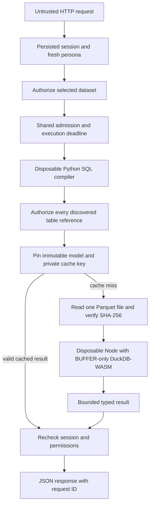

# How a SQL request stays within its permissions and resource budget

Django decides who may ask for data. A separate compiler decides which SQL language is allowed. A disposable engine receives only the authorized data bytes, and operating-system controls bound its work. These are four different protections: calling SQL “read only” would not establish all of them. Even a SELECT can read files, contact a network or consume excessive resources in a general-purpose engine.

Read the request path first, then use the boundary and limit sections as a reference. [API_CONTRACT.md](API_CONTRACT.md) defines client requests and errors; [BROWSER_WORKSPACE.md](BROWSER_WORKSPACE.md) explains the interface. Recorded verification and qualifications are in [NOTES.md](NOTES.md); [GitHub Actions](https://github.com/ricardorodab/arkham-challenge/actions) records subsequent CI runs.

## What is trusted, and what is protected

HTTP input and submitted SQL are untrusted. The host operator, Python application, SQL compiler/parser, JavaScript shim, installed dependencies and immutable publication catalog are trusted code or state. Product personas limit remote capabilities. They do not protect files from the operating-system account that owns the application or a host administrator.

Protected assets include authentication/session state, generated operator credentials, the worker's EIA credential, permitted analytical rows, publication integrity and limited query capacity. No endpoint accepts an EIA key, host path, arbitrary connection string, user ID or persona override. A facility filter narrows a query; it is not a separate tenant boundary. Analyst and Admin can access detail datasets, while Viewer can access only `national_daily` and `fleet_daily`.

## Follow one query from HTTP to response

1. Django middleware applies session, CSRF, host and security checks. The endpoint loads a fresh server-side actor rather than accepting a role from the caller.
2. The request body must be one UTF-8 JSON object, at most 32 KiB. Duplicate keys, unknown fields, invalid Unicode and non-finite constants are rejected.
3. The service authorizes the selected logical dataset before admission or parsing. Unknown and forbidden names receive the same denial.
4. Shared admission provides a slot and one execution deadline. Identity is checked again after waiting.
5. A disposable Python compiler discovers named sources, validates the allowed syntax and regenerates SQL. The service authorizes every discovered source before reporting a SQL shape error or opening analytical data.
6. The service validates any cursor, pins an immutable model and constructs an authorization/model/publication-bound cache key.
7. A cache miss validates the selected server-owned file descriptor, rejects symlinks/path escape, reads the whole selected Parquet file and checks its SHA-256. The engine receives bytes, not the file's host path.
8. A disposable Node process runs regenerated SQL in the restricted WASM engine. The supervisor bounds output, enforces the deadline and reaps the child.
9. The service pages the bounded ordered result and rechecks persisted identity before result/cache publication and delivery, including cache hits. Middleware adds safe headers, a request ID and sanitized operational logging.

Structured browsing uses the separate generated-plan native reader below. The SQL-editor path retains its compiler/WASM controls. A denial does not start either data query; a cached result does not authorize its recipient.

The source trail is [service URLs](../src/outage_explorer/service/urls.py) → [views](../src/outage_explorer/service/views.py) → [policy](../src/outage_explorer/service/policy.py) → [API services](../src/outage_explorer/service/api_services.py) → [compiler](../src/outage_explorer/query/sql_compiler.py) → [sandbox supervisor](../src/outage_explorer/query/query_sandbox.py) → [engine worker](../src/outage_explorer/sandbox/worker.cjs).

## Identity is checked against current server state

Django uses server-side persisted sessions and one product persona per user. The seeded Admin has no Django staff/superuser privilege. A staff flag, superuser flag, body field or browser control cannot select a product role; invalid or missing personas are denied.

[policy.identity](../src/outage_explorer/service/policy.py) reloads the active user and persona, then checks the persisted unexpired session, user ID, backend and authentication hash. Its HMAC binding includes user ID, persona, session key and authentication hash. `recheck` reloads and compares this identity after admission and before result/cache delivery. Session deletion, password change, account deactivation or persona change therefore affects an already-started request or cache hit. Already-delivered information cannot be remotely erased.

| Persona | Analytical access | Additional capability |
| --- | --- | --- |
| Viewer | Exactly `national_daily`, `fleet_daily` | None |
| Analyst | All ten registered analytical datasets | None |
| Admin | All ten registered analytical datasets | Refresh, readiness and its own refresh jobs |

Catalog filtering removes hidden datasets and foreign-key references to them. The static authenticated OpenAPI schema describes the whole API; it grants no permission and exposes no other persona's runtime rows. Service policy and `model_store._allowed` currently derive compatible permissions from the common dataset classifications; a future policy change needs cross-layer tests to keep them aligned.

Every mutation, including login, requires Django CSRF protection. Cookies authenticate; the CSRF token protects unsafe cookie-authenticated requests. Sessions are HttpOnly, SameSite=Lax, valid for 1,800 seconds and expire at browser close. Login rotates the CSRF token. Shared login throttles count successful and failed attempts: 10 per username and 30 per client address in five minutes, with `429` and `Retry-After` on saturation. HMAC bucket keys avoid storing raw names/addresses. The delivered runner uses `REMOTE_ADDR`; a remote proxy deployment requires a deliberate client-IP trust policy.

## The compiler permits a small language; it is not the engine sandbox

[sql_policy.py](../src/outage_explorer/query/sql_policy.py) is an AST allowlist compiler. An AST is the parser's structured representation of the SQL statement. The compiler validates specific node classes, arguments, columns, scalar types and functions, normalizes/quotes identifiers and regenerates SQL. The original submitted text is not sent directly to execution.

The supported language is one named-source SELECT: projection, filters, arithmetic/comparisons, grouping, HAVING, ordering, bounded LIMIT, basic aggregates and selected scalar functions/casts. It allows aggregate DISTINCT, such as `COUNT(DISTINCT ...)`, but not SELECT DISTINCT. Joins, CTEs, subqueries, windows, set operations, OFFSET, commands/mutations, table/file/network functions, arbitrary functions, CASE and NULLIF are excluded. The [API language contract](API_CONTRACT.md#sql-queries) gives the complete client-facing list.

Reference discovery includes names inside unsupported nested syntax, CTEs and joins. For example, a Viewer selecting a national dataset but referencing `generator_daily` inside `EXISTS (SELECT 1 FROM generator_daily)` receives a dataset denial before analytical I/O, even though subqueries are unsupported. Syntax rejection does not substitute for authorization.

| Compiler input or complexity | Limit |
| --- | --- |
| Source SQL and regenerated SQL | 16 KiB UTF-8 each |
| Tokens / AST nodes / nesting | 2,048 / 512 / 32 |
| String literal / identifier | 1 KiB / 128 bytes |
| Process protocol input / output | 32 KiB / 64 KiB |
| Wall subdeadline | At most two seconds of the shared eight-second budget |

Byte/token/nesting checks precede recursive parsing. Only one statement is accepted; SQLGlot's command fallback, which could log source text, is excluded. Parser logging is disabled in the worker. The strict response protocol returns static error codes rather than SQL/parser diagnostics. Adding a scalar function requires explicit AST-node/argument validation, output typing, generated-dialect compatibility, complexity bounds and abuse tests. A new preview filter must also preserve typed input validation, safe SQL generation, cursor binding and the API/browser contracts.

Ordinary SELECTs receive full-primary-key ordering tie breakers; grouped results receive group-key tie breakers; a scalar aggregate has at most one result row. An outer cap plus one private sentinel bounds retained rows without changing an explicit inner SQL LIMIT's ordinary meaning. Preview then uses keysets; SQL pagination slices the same deterministic capped result, not an unrestricted export.

Compilation runs under `Python -I -B -m outage_explorer.query.sql_compile_worker`, in a disposable resource-limited process with a scrubbed environment, bounded pipes and forced kill/reap. It receives no analytical bytes, data paths or application secrets and intentionally performs no analytical I/O. There is no in-process fallback.

This Python child is **not an operating-system filesystem jail**. Trusted application/parser/dependency code retains host-account authority. Its process/resource isolation and lack of supplied data capabilities are distinct from the engine restriction below.

## The engine receives one buffer, not access to the host filesystem

Trusted ingestion and model construction use native Python DuckDB **2.0.0**. Untrusted API SQL uses a new Node process hosting **`@duckdb/duckdb-wasm@1.33.1-dev57.0`**, engine **v1.5.4**, with **Node 24.13.0 or later within major 24**. `package-lock.json` pins the npm graph. Parquet compatibility and exact date/decimal serialization across the two engines have dedicated tests; their versions are not interchangeable claims.

The child receives exactly one authorized, checksummed Parquet byte buffer over stdin. It receives no dataset host path, other dataset, Django database, source key or inherited application environment. Trusted bootstrap registers `input.parquet` and creates the one logical dataset view.

The custom runtime uses **BUFFER-only** imports instead of the host-capable `NODE_RUNTIME`. File open/read/write/truncate/sync, directory listing/creation, moves/removal and scalar UDF callbacks are denied to the engine. HTTP/fetch/WebSocket paths are unavailable. Submitted SQL is never evaluated as JavaScript.

The packaged official Parquet extension has a fixed SHA-256 and is supplied locally through a narrow bootstrap-only bridge. That bridge serves only the exact pinned asset and closes before submitted SQL runs. Resolution/hash failures fail closed; requests do not download extensions. Bootstrap sets one engine thread and a 96 MB DuckDB memory setting, disables temporary spill storage, external access and automatic/community extensions, then locks configuration. [Runtime provenance](../src/outage_explorer/sandbox/PROVENANCE.md) records extension origin, license, hash and assumptions.

Node permission mode separately limits host reads to installed runtime files and exact shim/extension assets. Writes, child processes, workers, native addons, inspector and WASI are not granted. The child receives only timezone/language/warning configuration and necessary Windows runtime variables; no PATH, HOME, NODE_OPTIONS, EIA/Django/database/cloud credentials. Absolute executable/package paths avoid child PATH lookup. V8 old heap is 96 MiB; WASM linear memory is capped at 4,096 pages, or 256 MiB. WASM committed code is capped at 128 MiB. Linux also sets `--wasm-max-code-space-size-mb=128` to bound individual WASM code-space reservations and `--wasm-max-initial-code-space-reservation=32` to cap each initial reservation at 32 MiB. V8 can allocate additional code spaces within the separate hard limits; 32 MiB is not a total code or linear-memory ceiling. These settings are separate from the JavaScript code cage.

Node also rejects string-generated JavaScript with `--disallow-code-generation-from-strings` and sets `--disable-proto=throw` as additional hardening. These flags are defense in depth around the trusted worker, not an arbitrary-JavaScript sandbox.

The effective engine isolation is the **WASM import/capability boundary**. It is not Docker, a VM or Windows AppContainer. Node permissions are additional restrictions, not a promise to sandbox arbitrary malicious JavaScript. The shim/compiler/dependencies remain trusted. Changes to them require actual engine file/network canaries, configuration-lock and resource probes.

Typed serialization preserves decimals and 64-bit integers as strings, dates as ISO calendar strings, timestamps as ISO 8601, and nulls/booleans/text as JSON values. Non-finite, nested/list/binary results are rejected. The browser cannot recover numeric precision already lost in a JSON number.

## Capacity, deadlines and process limits

| Boundary | Implemented limit |
| --- | --- |
| Admission across HTTP processes | Two active slots; one pending/executing request per account; eight waiting slots; five-second maximum queue wait |
| Admitted compilation and execution | Eight-second wall budget, including startup/input preparation; compiler receives at most two seconds; queue wait excluded |
| Windows compiler/engine child | Job Object: hard 512 MiB process/job memory, six seconds user CPU, one process, kill-on-close |
| WASM/V8 | Hard 256 MiB WASM linear memory; 96 MiB V8 old heap; one engine thread/baseline compilation task |
| POSIX bootstrap | Compiler: RLIMIT_DATA 512 MiB. Linux engine: 1,024 MiB; other POSIX engines: 512 MiB. Both modes: six seconds CPU; no core/file output; 64 file descriptors |
| Data/result transport | One Parquet input ≤64 MiB; 1,000 client rows plus one private sentinel; 2 MiB output |
| HTTP/local WSGI | JSON body 32 KiB; Waitress body 64 KiB, headers 16 KiB, 32 connections, 12 request threads; 30-second channel timeout |

The trusted supervisor selects the bootstrap's `--engine` mode only for Node. On Linux, its 1,024 MiB DATA allowance budgets 512 MiB for the tested Node 24.13.0 x64 V8 JavaScript code-cage reservation and 512 MiB for other DATA-accounted mappings. V8 precommits this cage as writable and Linux counts it against RLIMIT_DATA, even while resident use remains much smaller. This is one shared data-allocation limit, not a total RSS/process-memory guarantee or the Windows Job limit. [Runtime provenance](../src/outage_explorer/sandbox/PROVENANCE.md) links the relevant V8 source.

Admission uses OS locks, so HTTP processes sharing the state directory share capacity and process death releases it. Reentrant work by the same user reuses the existing slot/deadline instead of resetting the budget. This is bounded polling admission, not a fair FIFO scheduler or a distributed cluster queue. It depends on compatible shared-filesystem locking semantics.

Cache hits still undergo admission, compilation and authorization. A SQL LIMIT caps output, not aggregate/sort work. The process/time/memory limits contain that work. The supervisor drains and bounds both output pipes, discards private diagnostics, kills on timeout/overflow/error and reaps the child.

Public timeout is `504`; result overflow is `413`; safe execution/resource/type failure is `422`; compiler unavailability/resource/protocol failure is `503 compiler_unavailable`. Missing engine runtime is `503 sandbox_unavailable`. No fallback widens authority. API details are in the [error contract](API_CONTRACT.md#errors-and-health).

**The recorded Windows delivery verified Job limits and real dataset queries.** A targeted probe with official Node 24.13.0 on Linux x64 under WSL also completed a real Parquet count with the revised 1,024 MiB DATA limit; sampled peak RSS was about 278 MiB while VmData reached about 1,002 MiB. This probe does not establish full Linux or macOS acceptance. Validate the complete release on its deployment platform; consult [GitHub Actions](https://github.com/ricardorodab/arkham-challenge/actions) for subsequent CI results.

## Immutable data, cache and cursor integrity

The server selects immutable model descriptors, validates model/file names and symlinks, and SHA-256 verifies the entire selected file before engine delivery. The catalog publishes matching raw/model references together in one transaction after files are ready. Failures before that transaction leave the prior pair current. Unreferenced staging or immutable candidates can remain after interruption; recovery does not automatically promote or delete them. The [data guide](DATA_PIPELINE_AND_MODEL.md) explains publication in full.

File hashes establish agreement with a trusted manifest. They are not signatures against a host administrator who can edit both files and catalog. Dependency/data directories and the operator remain trusted.

The private SQLite result cache binds user, persona, session/authentication state, canonical SQL/caps/page size, selected immutable model and current publication model ID. It lasts 60 seconds, retains up to eight entries per user and does not extend expiry on hits. Authorization precedes lookup and is checked before delivery. HTTP responses remain `no-store`; HTTP caching and authorized server result caching are separate mechanisms.

Signed cursors expire after 15 minutes and bind the actor, query/filter parameters, limits and model. They are not encrypted, authentication credentials or caller-selected offsets. Structured browsing uses requested sort keys plus unique PK ties; SQL pages within its retained cap. A cursor can keep an old model pinned while a new publication retires cache generations. Immutable model retention therefore needs a future garbage-collection policy coordinated with cursor lifetime and active readers.

## Structured browsing has a separate trusted reader

Explore submits a closed search/filter/order specification, not SQL. [The pure browse compiler](../src/outage_explorer/query/browse.py) allows declared dataset columns, type-compatible operators and bound values only. The child independently validates the canonical plan and generates a projected SELECT with total ordering, NULLS LAST, exact seek operands and LIMIT plus one sentinel. There is no caller-supplied expression, join, function, path or SQL statement inlet. The existing SQL editor still uses the compiler/WASM capability boundary; it cannot opt into native execution.

[The native supervisor](../src/outage_explorer/query/browse_runtime.py) authorizes through the service, rejects symlink/reparse components, pins the selected regular file and checks its expected manifest SHA-256. A process-local LRU retains at most 128 verified `(path, checksum, file identity, size, mutation timestamps)` entries, never file bytes. Cold hashing uses bounded chunks and the same execution deadline; warm requests still check identity before/after reading. File replacement or ordinary modification invalidates verification. The cache trusts immutable publication and host metadata, not a host writer capable of rewriting files/manifests and restoring every fingerprint field. Windows keeps a read-only handle that denies write/delete sharing and checks explicit file ChangeTime; POSIX passes its read-only descriptor to the child.

The disposable native worker uses one DuckDB thread and a 256 MB engine limit, with separate 512 MiB process supervision, six CPU seconds, the shared eight-second wall deadline, bounded input, 1,001 rows including the sentinel and 2 MiB output. It disables extension installation/autoload, community/unsigned extensions, persistent secrets, spill storage and external access; the exact selected file is allowlisted before configuration is locked. `allowed_paths` permits access, not OS read-only permission. This trusted generated-SELECT path is not a general filesystem/network jail, and DuckDB's memory setting is not a complete RSS cap. See [DuckDB security](https://duckdb.org/docs/2.0/operations_manual/securing_duckdb/overview) and [resource settings](https://duckdb.org/docs/2.0/configuration/pragmas#resource-management).

The reader does not copy an entire Parquet file into Python, a pipe, WASM or the browser. DuckDB can use projection/filter pushdown and row-group statistics, while small ORDER BY LIMIT plans can use TOP_N. Seek predicates avoid deep OFFSET heap growth; they do not create an index or guarantee logarithmic access. Global lower/cast/substring search may scan many candidates, and requests exceeding resource limits fail safely. No filtered COUNT runs per page. [Parquet pushdown](https://duckdb.org/docs/2.0/data/parquet/overview) and the [TOP_N optimizer](https://github.com/duckdb/duckdb/blob/v2.0.0/src/optimizer/topn_optimizer.cpp) describe these limits.

[Scale verification](BROWSE_PERFORMANCE.md) records the actual 3-million-row, 102.6 MiB production-path measurements, cache conditions and resource observations on Windows and Linux Docker.

## Refresh has three different concurrency controls

HTTP requests persist jobs; they do not read EIA credentials or start ingestion threads. [Refresh models](../src/outage_explorer/service/models.py) enforce one queued/running job globally, unique owner/idempotency-key pairs and valid mode/status values. The same owner/key/mode replays the original outcome; a changed mode conflicts. See the [refresh API](API_CONTRACT.md#asynchronous-refresh).

| Control | Purpose |
| --- | --- |
| Service database constraints | Resolve competing enqueue attempts and idempotent retries |
| Worker lifetime OS control lock | Exclude a second live worker and permit recovery of abandoned running jobs |
| Data writer OS lock | Protect extraction/model publication from competing writers, including CLI ingestion |

The separate worker first acquires its control lock, then can recover `running → interrupted`. A second live worker cannot falsely recover the first. It claims queued work through a conditional update and rechecks the owner's active Admin persona before extraction. No Django transaction spans network extraction. Revocation after extraction begins does not cancel an already-running extraction.

`perform_ingest` reads only explicitly supplied `EIA_API_KEY`; it does not read `key.txt`. It verifies source/model association and can identify its own immutable publication if an independent CLI writer later advances current state. Success records verified IDs/mode, then best-effort cache cleanup; generation-specific keys preserve safety if cleanup fails.

**Analytical publication and job completion are separate transactions in separate databases.** Both SQLite stores use WAL and `synchronous=FULL`; these settings do not create an atomic cross-database transaction or a power-loss/backup guarantee. A crash after catalog publication but before job success can leave published data and an interrupted job. Inspect source/model history before retrying. There is no distributed transaction or exactly-once completion claim. Hard process-death recovery and live-worker exclusion have dedicated tests.

## Local credentials, HTTP and browser trust

`web.local init` explicitly creates random Django/persona inputs in ignored `.service/local-config.json`, migrates the service database and seeds `viewer`, `analyst`, `admin`. There are no shipped/default passwords. Creation uses exclusive file creation and fsync, POSIX mode 0600 or a new-file owner-only NTFS ACL. Passwords are hashed in Django. Repeated setup preserves passwords unless `--reset-passwords` is supplied; privileged/conflicting identities require reconciliation.

That JSON accepts exactly the generated Django key and three seed passwords. Other effective settings come from process environment or defaults in code; `.env.example` and a renamed `.env` are not automatically loaded. [PROJECT_TOUR.md](PROJECT_TOUR.md) explains precedence and [LOCAL_OPERATIONS.md](LOCAL_OPERATIONS.md) gives commands.

The serving wrapper removes EIA/seed-password environment entries; the worker retains an explicitly supplied EIA key and removes seed-password entries. Compiler/engine environments are scrubbed regardless of the parent. This is process separation under the same host account, not a separate OS principal incapable of reading local files. `.service` contains sessions, jobs, cached rows and private configuration and requires trusted ownership; the config-file ACL does not isolate every application file.

The delivered Waitress runner binds `127.0.0.1`, clears untrusted proxy headers and hides tracebacks. Ordinary settings default DEBUG false, allow only localhost/127.0.0.1, and use local HTTP. Testserver is confined to test settings. A Django key requires ≥50 characters, ≥5 distinct characters and no `django-insecure-` prefix. `OUTAGE_LOCAL_HTTP=0` enables Secure cookies and HTTPS redirect; it does not provision TLS or configure trusted proxies. No credential-sharing CORS policy is enabled. Remote hosting still requires TLS, reviewed hosts/proxy trust, operator access, backups, monitoring and target-platform runtime acceptance. OAuth/OIDC, tenant row/column security and horizontal multi-host operation are future scope.

API headers include request ID, no-store, nosniff, frame denial and restrictive CSP. HTML permits self-only scripts/connections and self-hosted styles; CodeMirror-generated style sheets require a fresh per-response CSS nonce. Inline scripts, eval and arbitrary inline style attributes remain blocked. API CSP denies content capabilities. Templates escape identity and use inert `json_script`; browser values become text nodes. Public assets use a fixed filename allowlist, nosniff and ETag revalidation. They cannot select host paths.

Logs record safe route/method/status/duration/request IDs, lifecycle IDs/statuses and sanitized events. Public errors omit SQL, credentials, host paths, raw source echoes and engine diagnostics. Bodies, passwords, cookies, original/generated SQL and raw child stderr are not logged. Liveness means HTTP responds. Admin readiness resolves a model and verifies pinned runtime availability; it makes no EIA call and runs no complete query or workload benchmark.

The browser's opaque session-scope HMAC is neither a raw session ID nor a bearer credential. Identity-only protected HTML is rechecked after rendering; each data/job request still needs API authorization. Session replacement/revocation disposal, restore checks, CSV guards and the limits of browser erasure are detailed in [BROWSER_WORKSPACE.md](BROWSER_WORKSPACE.md).

## Capacity limits to explain before proposing a larger deployment

For arbitrary user SQL, a 100× data/user scenario remains a planning question, not a measured load result. A cache miss reads/hashes the entire selected Parquet file, copies it through Python/pipe/Node/WASM, and cold-starts compiler plus engine. Predicate pushdown inside DuckDB cannot avoid Python's initial whole-file read. That path retains its intentional 64 MiB ceiling. Structured browsing uses the separately measured native reader above; the 3-million-row benchmark does not establish concurrent-user throughput.

Two admitted request slots do not cap all service memory: parent buffers/copies, Python objects, HTTP threads, the service database and runtime allocations add overhead. Eight cache entries per user is not a global byte budget; many users and large results can pressure SQLite/storage, while cleanup is opportunistic. Authentication/compiler/admission work remains on cache hits. Queues protect availability without increasing throughput or promising fairness.

SQLite and local OS locks fit a single-host product. Growing sessions, cache writes, jobs and concurrent users introduce contention. Possible future designs include PostgreSQL state, an explicit job queue/distributed admission, partitioned object-store Parquet and measured engine pooling or a containerized read-only query service. These are alternatives, not implemented features. Preserve authorization and model pinning while measuring before choosing infrastructure.

## Verification mechanisms and their limits

These tests probe executable boundaries rather than only matching forbidden SQL strings. Results, versions, dates, failures and skips belong in [docs/NOTES.md](NOTES.md); test existence is not a fresh passing result.

| Boundary | Source of executable checks |
| --- | --- |
| Persona/session revocation, cache/cursor ownership, CSRF, no analytical I/O on denial, spoofed-role/staff rejection | [API security](../tests/test_api_security.py), [API contract](../tests/test_api.py), [validation](../tests/test_api_validation.py), [in-flight revocation](../tests/test_session_revocation.py) |
| AST shape/complexity/references; child parsing, scrubbed environment, strict protocol, hung/output-flood reaping, no fallback | [SQL policy](../tests/test_sql_policy.py), [compiler](../tests/test_sql_compiler.py) |
| Real host-file/COPY/ATTACH/network canaries deliberately bypassing AST policy; locked configuration; scalar, row/byte, memory, wall-time and subsequent-recovery probes | [WASM sandbox](../tests/test_query_sandbox.py) |
| Shared/reentrant deadline, per-user/global/queue bounds and real cross-process locks | [Admission](../tests/test_query_admission.py) |
| Concurrent enqueue winner, job constraints, joint publication/failure preservation, source/model association, live-worker exclusion and real hard-kill recovery | [Refresh service](../tests/test_refresh_service.py) |
| Generated/private setup, password preservation, conflicting identities, environment cleanup | [Service setup](../tests/test_service_setup.py), [local operator](../tests/test_local_operator.py) |
| Published schema and response consistency | [OpenAPI](../tests/test_openapi.py) |

The sandbox engine suite visibly skips if the runtime is unavailable. Such a skip is not isolation evidence; release acceptance requires actual pinned runtime probes on its target platform. CI configuration is not evidence that remote CI ran. The historical November 2 full Python result was **654 passed, one failed, one skipped**, including a failure of the 50 ms timeout-startup assumption. This is a historical result; [GitHub Actions](https://github.com/ricardorodab/arkham-challenge/actions) records subsequent runs.

## Source-reading route

Read `urls.py` → `views.endpoint/body/query` → `policy.identity/authorize_dataset/recheck` → `api_services._query/_validate/_run` → `sql_policy.validate_sql/_stable_order` → `sql_compiler.compile_sql` → `query_sandbox.run_query/_capture` → `worker.cjs:execute` → refresh/models/admission. Start with the request-flow diagram, then locate each boundary in code.

## Saved definition authorization

Saved views persist SQL and presentation settings in the application database, with no analytical row snapshot. Only Analyst/Admin may create/edit/share; only owners mutate/delete. Private is the default. Explicit role audiences never bypass current dataset policy, including when listing names, retrieving query text or running a definition. Viewer national-data restrictions apply to every shared execution. Owners can delete an existing permitted definition after a downgrade; this does not grant saved-query authoring.

Every run uses the reader's Actor, existing SQL compiler/sandbox, model pin and private query cache. Definition revision and audience are rechecked after execution; deleting or unsharing during a long run prevents result delivery. Signed actor-bound list cursors, strict bounded bodies, quota50, short serialized metadata writes, CSRF and optimistic revision checks protect the management path. Shared recipients receive the saved SQL text intentionally. Creation-model metadata is provenance, not a capability to read an otherwise forbidden publication or dataset.
