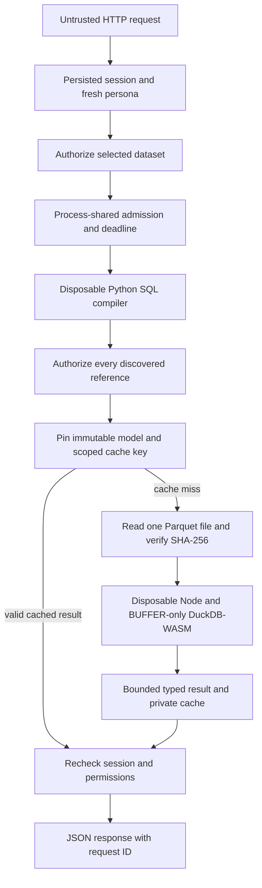

# Security boundaries and operating assumptions

The API treats HTTP input and submitted SQL as untrusted. The host operator, Python application, SQL compiler, JavaScript shim, dependency installation and immutable publication catalog are trusted code/state. Product personas constrain remote capabilities; they do not protect files from the operating-system account that owns the application or an administrator of that host.

The protected assets are authentication/session state, generated operator credentials, the worker's EIA credential, authorized analytical rows, publication integrity and bounded query capacity. No API accepts an EIA key, host path, arbitrary connection, user ID or persona override. Facility filters are query filters, not a separate tenant authorization boundary: Analyst/Admin are permitted the detail datasets, while Viewer is limited to the two national datasets.

## Request, identity and data access

The application uses Django server-side sessions and a single OneToOne product persona per user. Seeded Admin is a product role with **no Django staff/superuser privilege**. Missing/invalid personas are denied. Each protected request reloads the active user/persona and checks the persisted, unexpired session, backend and authentication hash. Rechecks occur after query admission and before result delivery, including cache hits. Password changes, session deletion, deactivation and persona changes therefore do not rely on a stale role stored in the browser or a cached result.

Viewer's permitted analytical datasets are exactly `national_daily` and `fleet_daily`. Catalog responses remove hidden datasets and FK references to them. Unknown/forbidden logical names have the same denial. Query table references, including those discovered in unsupported nested syntax, are authorized before analytical files are opened. Selected bytes come from server-owned, immutable model descriptors; model/file names and symlinks are checked, and the entire selected Parquet buffer is SHA-256 verified before being sent to the engine. The API never returns host paths, raw-source HTTP echoes or a directory-listing capability.

The diagram describes the query path. Previews construct server-owned filter SQL and pass it through the same compiler/engine controls. Both paths use one query-admission slot throughout compilation and execution. A denial never starts a data query, and a cache does not authorize a request by itself.

## SQL compilation is isolated from the HTTP process

SQLGlot is an **allowlist compiler**, not the engine's filesystem sandbox. It accepts one named-source SELECT with explicitly supported nodes, arguments, columns, scalar types and aggregate operations. Joins, CTEs, subqueries, windows, unions, commands, mutations, table functions and arbitrary functions are rejected. Source SQL is parsed and regenerated; only the generated statement reaches execution. See the exact language contract in [API.md](API.md) and [sql_policy.py](../src/outage_explorer/sql_policy.py).

Compilation runs in a disposable `Python -I` child with a **two-second wall subdeadline**, bounded input/output and OS resource limits. SQL is not parsed recursively inside a Django request process. UTF-8 SQL is capped at 16 KiB, token count at 2,048, AST nodes at 512, nesting depth at 32, string literals at 1 KiB and identifiers at 128 bytes. Compilation returns references even when the supported shape fails, allowing the web service to authorize those references before raising the shape error. There is no in-process fallback if the compiler cannot start or respect its contract.

The compiler receives no analytical file bytes, source paths or inherited application secrets, and its trusted code performs no analytical I/O. It is a resource-isolated Python process, **not an OS filesystem jail**. Dependency/parser code remains trusted. The engine's stronger file-capability restriction is a separate boundary described below.

## Engine isolation: WebAssembly with buffer-only capabilities

Untrusted SQL runs in **DuckDB-WASM**, never the native in-process DuckDB connection used for ingestion/model construction. Each execution gets a new Node process and only one authorized, checksummed Parquet byte buffer over stdin. The selected dataset's host path, Django SQLite database, other datasets, source credentials and application environment are not supplied to that child. Logical source registration is performed by trusted bootstrap code.

The pinned runtime is `@duckdb/duckdb-wasm@1.33.1-dev57.0`, reporting engine `v1.5.4`, with **Node 24.13.0 or later within major 24**. `package-lock.json` pins npm dependencies. The packaged official Parquet extension has a pinned SHA-256 and is supplied locally during bootstrap. Runtime resolution/hash failures fail closed; a query does not download extensions. Source ingestion/modeling independently uses the pinned native Python DuckDB version; engine versions should not be conflated.

The custom shim uses **BUFFER-only** imports rather than DuckDB-WASM's host-capable `NODE_RUNTIME`. File open/read/write, filesystem enumeration, directories, scalar UDF callbacks and related host capabilities are denied to the engine. HTTP/fetch/WebSocket paths are unavailable. The bootstrap-only extension bridge serves one exact pinned local asset and closes before submitted SQL executes. DuckDB external access and automatic/community extensions are disabled, temporary spill storage is disabled, and configuration is locked.

Node permission mode independently restricts host reads to installed runtime files and exact shim/extension assets; file writes, child processes, workers, native addons, inspector and WASI are not granted. The child receives a minimal runtime environment rather than inherited EIA/Django/cloud credentials or `NODE_OPTIONS`. Submitted SQL is never evaluated as JavaScript.

The effective isolation mechanism is the **WASM import/capability boundary**. This is not Docker, a VM or Windows AppContainer, and Node permission mode is not a promise to sandbox arbitrary malicious JavaScript. The shim, compiler and installed dependencies are trusted; dependency changes require rerunning engine-level file/network canaries, configuration-lock and resource probes. [Runtime source/provenance](../src/outage_explorer/sandbox/PROVENANCE.md) documents the extension origin, hash and these assumptions.

## Resource controls and platform evidence

| Boundary | Implemented limit |
| --- | --- |
| Admission across HTTP processes | Two active slots, one pending/executing request per account, eight waiting slots; five-second maximum queue wait |
| Shared admitted execution | Eight-second wall budget across compiler/engine startup, input preparation and execution; compiler receives at most two seconds |
| Windows compiler/engine child | Job Object: hard 512 MiB process/job memory, six seconds of user CPU, one process, kill-on-close |
| WASM engine | Separate hard 256 MiB linear-memory ceiling; V8 old heap 96 MiB; one engine thread and baseline compilation task |
| POSIX child bootstrap | `RLIMIT_DATA` 512 MiB, `RLIMIT_CPU` six seconds, no core/file output, 64 file descriptors |
| Data/result transport | One input Parquet file up to 64 MiB; 1,000 client result rows plus one private sentinel; 2 MiB bounded output |
| HTTP/local WSGI transport | JSON body 32 KiB; Waitress body ceiling 64 KiB, headers 16 KiB, 32 connections and 12 request threads |

Admission uses OS locks rather than process-local counters, so multiple HTTP processes share the limits and process death releases admission capacity. Cache-hit requests also undergo admission and compilation. The five-second queue wait is separate from the execution budget. A SQL `LIMIT` does not bound the cost of an aggregate or sort; process/time/memory limits supply that protection.

The supervisor bounds both child output pipes, discards private diagnostics, kills the child on timeout/overflow/error and reaps it. Public deadline errors are `504`; result overflow is `413`; execution/resource/type failures are safe `422` responses. Compiler unavailability/resource failure is `503 compiler_unavailable`. There is no native-engine execution fallback.

**Windows is the live-verified platform for the hard Job limits and actual dataset queries in this delivery.** The POSIX launcher is implemented, but Linux/macOS runtime acceptance has not been performed on this Windows host. `RLIMIT_DATA` is a data-allocation ceiling, **not an RSS/total-process-memory claim**. The POSIX path must be validated on its deployment platform before promising equivalent operational behavior. The Windows and POSIX controls are deliberately described separately.

## Cache, cursors and publication integrity

The internal result cache is private to the owner/persona/session/authentication binding, canonical SQL/cap/page size, selected immutable model and **current publication's model ID**. It expires after 60 seconds and applies an eight-entry-per-user retention policy. Authorization precedes lookup and is checked again before delivery. HTTP responses remain `no-store`; an internal cache hit does not authorize access or extend cache expiry.

Signed cursors expire after 15 minutes and bind the authorization context, query/filter parameters and model. Tokens are signed rather than encrypted and are not a substitute for the session. Preview continuation uses full-PK keysets; SQL continuation pages a capped ordered result. A new publication can invalidate cache generations while an existing cursor continues its explicitly pinned model.

Raw/model bundles are immutable and published as a matching pair in one catalog transaction. Failures before publication leave the prior pair current. SHA-256 checks bind selected bytes to their published manifest; they are integrity checks, not a signature against a host administrator able to alter both catalog and files. The application operator and dependency/data directories remain a trust boundary.

## Refresh worker and credential separation

HTTP requests only persist an Admin-owned job. They never start a refresh thread or read an EIA key. Database constraints allow at most one queued/running job globally and deduplicate owner/idempotency-key pairs. The separately started worker revalidates the active Admin owner, holds an independent OS control lock for its lifetime, then calls the existing ingest/model pipeline under its data writer lock. No Django transaction is held across network extraction.

Only acquiring that worker control lock permits recovery of `running → interrupted`; starting another live worker cannot falsely recover an active job. Hard process-death recovery is tested. A crash after the catalog commits but before the job records success can yield an interrupted job **with data already published**. Operators must inspect publication/model history before retrying; the service does not claim interruption always rolled publication back. Successful jobs record only verified source/model IDs and mode; best-effort cache cleanup is backed by generation-specific cache keys.

`python -m outage_explorer.web.local init` creates random Django and persona credentials in ignored `.service/local-config.json`, migrates the service DB and explicitly seeds `viewer`, `analyst`, `admin`. New credential files receive POSIX mode `0600` or an owner-only NTFS ACL; account passwords are hashed in Django. Repeated setup preserves passwords unless `--reset-passwords` is supplied, and preexisting privileged/conflicting identities require explicit reconciliation. There are no shipped/default passwords. The private configuration file contains credentials and belongs in the operator's protected state, not source control or API responses.

`...web.local serve` removes EIA/seed-password environment entries before serving. `...web.local worker` receives an EIA credential only if the operator supplies `EIA_API_KEY` separately; **`key.txt` is not automatically read**. The Node/SQL compiler children receive a scrubbed environment regardless of the parent's environment. Advanced manual `...web.manage` commands require the corresponding environment configuration; running the local wrapper does not turn the web API into a credential-management endpoint.

`.service` contains authentication sessions, job history and cached authorized results as well as local operator configuration; it and the data/dependency directories require trusted ownership/permissions. The generated configuration-file ACL does not claim to isolate all application files from other host users. Local privileged administration and compromise of trusted application/dependency code are outside the persona boundary.

## HTTP, logging and deployment scope

The delivered Waitress runner binds **127.0.0.1**, clears untrusted proxy headers and does not expose tracebacks. Production settings default to `DEBUG=False` and allow only `127.0.0.1`/`localhost` host headers; `testserver` is confined to test settings. Django secret keys must have at least 50 characters, at least five distinct characters and no `django-insecure-` prefix. Generated local credentials satisfy that requirement.

Every mutation, including login, requires Django CSRF protection. No CORS credential-sharing policy is enabled. Session cookies are HttpOnly, SameSite=Lax and expire after 1,800 seconds/browser close. `OUTAGE_LOCAL_HTTP=1` is the explicit default for the loopback HTTP demonstration. `OUTAGE_LOCAL_HTTP=0` enables Secure session/CSRF cookies and HTTPS redirect. It does **not** provision TLS: remote deployment requires a reviewed TLS/trusted-proxy/host configuration; the current local runner deliberately does not trust forwarded headers automatically.

API responses carry request IDs, `no-store`, `nosniff`, frame denial and a restrictive content-security policy. Values remain JSON data, including text that resembles markup; a future HTML client must render them as text. Public errors are structured and omit SQL, file paths, source credentials and raw engine diagnostics. Application logs contain safe route/method/status/duration/request IDs, lifecycle IDs/statuses and sanitized operation events, not request bodies, passwords, cookies, original/generated SQL or raw child stderr.

## Verification

The checks are executable, rather than claims based solely on blocked SQL strings:

| Evidence | Tests |
| --- | --- |
| Persona/session revocation, cache isolation, cursor binding, CSRF, metadata/row denials | [API security](../tests/test_api_security.py), [API contract](../tests/test_api.py), [validation](../tests/test_api_validation.py) |
| AST subset, complexity, rejected references and bounded compiler process/protocol | [SQL policy](../tests/test_sql_policy.py), [SQL compiler](../tests/test_sql_compiler.py) |
| Real engine file/network canaries without relying on AST rejection; exact scalar/resource probes | [WASM sandbox](../tests/test_query_sandbox.py) |
| Real hard-kill worker recovery, live-worker exclusion, joint publication/failure preservation | [Refresh service](../tests/test_refresh_service.py) |
| No default/reset passwords, private local setup, secure configuration | [Service setup](../tests/test_service_setup.py), [local operator](../tests/test_local_operator.py) |
| Published schema and runtime response consistency | [OpenAPI](../tests/test_openapi.py) |

The final run results, required runtime availability and any platform skips belong in [PART3_ACCEPTANCE.md](../PART3_ACCEPTANCE.md). An unavailable sandbox test runtime is a visible skip, not evidence that engine isolation passed; release acceptance requires the real pinned runtime probes on the target platform.
